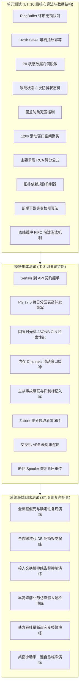
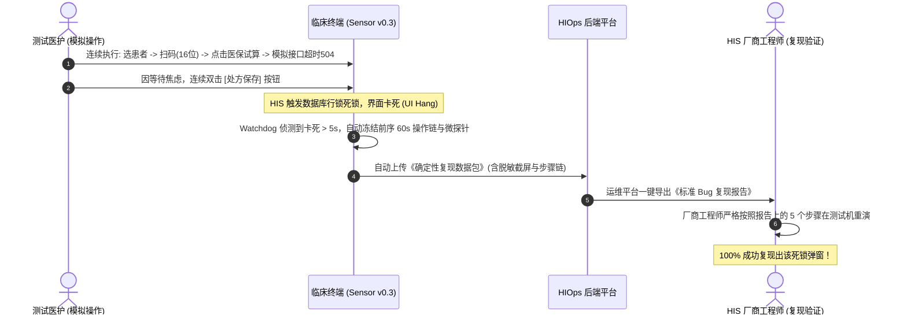

# HIOps 医院智能信息运维平台 — 全流程测试用例规范 (UT / IT / ST)

> **文档编号**: HIOps-TC-2026-V2.0  
> **编制日期**: 2026-10-22  
> **测试体系**: 覆盖**单元测试 (Unit Test)、集成测试 (Integration Test)、系统级端到端测试 (System Test)** 三级验证金字塔  
> **设计目标**: 提供可直接转化为自动化测试脚本（xUnit / NUnit / Postman / E2E 自动化）的高标准用例清单，**严格闭环验证“难复现、告警风暴、先于临床感知、主要矛盾定位”等核心需求**，确保系统在全院 1000+ 终端上线的确定性与高质量。

---

## 1. 测试策略与分层质量门禁

### 质量门禁准则 (Quality Gates):
1. **单元测试 (UT)**: 核心算法与数据结构代码覆盖率必须达 **100%**，整体后端与探针代码覆盖率 $\ge 85\%$，自动化 CI 构建必须“全绿”通过；
2. **集成测试 (IT)**: 在模拟 1000 终端并发压力下，API 吞吐量 $\ge 500\text{ RPS}$，PG 17.5 分区表写入延迟 $\le 5\text{ms}$，无死锁；
3. **系统测试 (ST)**: 6 组核心业务实操场景 100% 验收通过，导出的《确定性复现包》可由第三方独立还原 Bug。

---

## 2. 单元测试用例集 (Unit Tests - UT)

### UT-01: 因果时光机环形无锁缓冲区溢出覆盖测试
- **测试类**: `ActionTrailRingBufferTests.cs` (C# .NET 4.8)
- **测试方法**: `RingBuffer_ShouldMaintainFIFO_WhenCapacityExceeded()`
- **前置条件**: 实例化容量为 50 的 `ActionTrailRingBuffer`。
- **测试输入**: 循环调用 `Enqueue()` 写入 120 条 `ActionEntry` 数据。
- **预期输出与断言**:
  - `Dump()` 返回的列表长度严格等于 50；
  - 队列中第一条数据的时间戳与内容为第 71 条输入，最后一条为第 120 条输入；
  - 内存无泄漏，读写锁在并发多线程写入下无死锁（耗时 $<5\text{ms}$）。
- **合格标准**: 断言全部通过。

### UT-02: 崩溃堆栈 SHA1 指纹计算幂等性测试
- **测试类**: `CrashFingerprintGeneratorTests.cs`
- **测试方法**: `Generate_ShouldReturnIdenticalHash_ForSameException()`
- **测试输入**: 输入两组相同的崩溃上下文（`Process="HIS.exe"`, `Module="oraoci.dll"`, `Code="0xc0000005"`, `Offset="0x00014B20"`）。
- **预期输出**: 生成的 16 进制 Hash 字符串完全一致（如 `A9F3C184E0B195C8`），输入参数微调时生成不同 Hash。
- **合格标准**: 100% 幂等。

### UT-03: 敏感个人隐私 (PII) 图像几何脱敏测试
- **测试类**: `PiiMaskingEngineTests.cs`
- **测试方法**: `MaskBitmap_ShouldObscurePatientRegions_WithoutDistortingErrorText()`
- **测试输入**: 输入一张包含患者身份证（坐标 $X:100, Y:80$）、姓名及中央报错对话框（坐标 $X:300, Y:200$）的位图。
- **预期输出**:
  - 坐标 $(100, 80)$ 区域的像素均方差接近 0（纯黑矩形或高斯模糊模糊半径 $>15$），OCR 无法识别出原始字符；
  - 报错对话框区域像素无损，OCR 仍能 100% 正确提取出“ORA-00054”。
- **合格标准**: 敏感区域不可逆脱敏，错误框无损。

### UT-04: 软状态 (Soft) 到硬状态 (Hard) 3 次防抖状态机测试
- **测试类**: `DebounceStateMachineTests.cs`
- **测试方法**: `State_ShouldOnlyTransitionToHard_AfterThreeConsecutiveFailures()`
- **测试步骤**:
  - 步骤 1: 注入 1 次网络丢包 $\to$ 状态保持为 `SOFT_ALERT`，不触发外部通知；
  - 步骤 2: 下一周期网络恢复 $\to$ 状态自动复位为 `NORMAL`（偶发瞬时毛刺被成功过滤）；
  - 步骤 3: 连续注入 3 次网络丢包 $\to$ 状态正式变更为 `HARD_ALERT`，触发事件输出。
- **合格标准**: 状态转移完全符合预设模型。

### UT-05: 动态回差防跳 (Hysteresis) 死区控制测试
- **测试类**: `HysteresisControllerTests.cs`
- **测试方法**: `Alarm_ShouldNotOscillate_WhenMetricFlapsInDeadband()`
- **前置条件**: 设定告警阈值 85%，恢复阈值 70%。
- **测试输入**: 指标时序序列为：$80\% \to 86\% \text{(触发告警)} \to 82\% \to 78\% \to 84\% \to 68\% \text{(触发消警)}$。
- **预期输出**: 在 $70\% \sim 85\%$ 的死区震荡期间，告警状态保持激活，**全程仅产生 1 次告警与 1 次消警**，未产生反复刷屏。
- **合格标准**: 震荡期间无重复事件生成。

### UT-06: 120 秒多维滑动窗口聚类分组算法测试
- **测试类**: `SlidingWindowCorrelatorTests.cs`
- **测试方法**: `Correlator_ShouldClusterEvents_BySegmentAndSwitch()`
- **测试输入**:
  - 在 120s 窗口内，传入 3 个来自同一网段 `192.168.20.` 的超时事件；
  - 传入 1 个来自 `192.168.10.` 的超时事件。
- **预期输出**:
  - 前 3 个事件被聚合为 1 个关联组，产生 1 个 P2 级局部网络事故候选单；
  - 第 4 个孤立事件保持为独立的 P4 单机事件。
- **合格标准**: 正确分组与收敛。

### UT-07: 主要矛盾 RCA 算分公式准确性测试
- **测试类**: `PrincipalRcaArbiterTests.cs`
- **测试方法**: `Arbiter_ShouldScoreDatabaseLockHigher_ThanClientHang()`
- **测试输入**: 模拟并发事件集：
  - 事件 A: 10:14:05 Oracle DB 行锁等待（深度权重 1.0）；
  - 事件 B: 10:14:10 终端 HIS 界面假死（深度权重 0.1）。
- **预期输出**: 事件 A 的综合根因得分 $\ge 0.88$，事件 B 得分 $\le 0.35$；系统判定事件 A 为“主要矛盾”。
- **合格标准**: 判定结论与置信度符合预期。

### UT-08: 拓扑依赖规则抑制器测试
- **测试类**: `TopologicalInhibitionEngineTests.cs`
- **测试方法**: `Engine_ShouldSuppressChildAlerts_WhenParentIsDown()`
- **测试输入**: 拓扑注入核心交换机 `SW-CORE-01` 离线；随后传入挂接在其下方的 5 台接入交换机离线事件。
- **预期输出**: 5 台接入交换机的事件属性 `is_suppressed` 被置为 `true`，`suppress_reason` 标记为 `TOPOLOGY_PARENT_DOWN`。
- **合格标准**: 次生告警全部被静默标记。

### UT-09: 业务吞吐量“断崖下跌”突变检测算法测试
- **测试类**: `PlungeDetectorTests.cs`
- **测试方法**: `Detector_ShouldFlagPlunge_WhenDropExceeds80Percent()`
- **测试输入**: 动态基线设定当前分钟期望业务量为 200 笔/分；连续 2 分钟传入实际业务量为 15 笔/分。
- **预期输出**: 跌幅达到 $92.5\% \ge 80\%$，`is_plunge_anomaly` 判定为 `true`，直接触发 P1 重大事故生成。
- **合格标准**: 120 秒内产生断崖异常标记。

### UT-10: 离线缓冲队列 FIFO 磁盘淘汰测试
- **测试类**: `OfflineSpoolerTests.cs`
- **测试方法**: `Spooler_ShouldEvictOldestPacket_WhenDiskLimitExceeded()`
- **前置条件**: 设定本地暂存上限为 5MB（测试阈值）。
- **测试输入**: 连续写入 10 个 1MB 大小的加密取证数据包。
- **预期输出**: 磁盘实际占用始终维持在 $\le 5\text{MB}$，最早存入的前 5 个数据包被静默淘汰，保留最新的 5 个数据包。
- **合格标准**: 无磁盘溢出报错，保留最新数据。

---

## 3. 集成测试用例集 (Integration Tests - IT)

| 用例编号 | 模块集成链路 | 测试输入与验证动作 | 预期结果与合格标准 |
|---|---|---|---|
| **IT-01** | **Sensor $\to$ API Gateway** | Sensor 打包脱敏 JSON 报文，通过出站 HTTPS POST 发往 `/api/v1/sensors/forensics/report`。 | HTTP 200 返回；网关校验 Token 与指纹合法；数据在 50ms 内进入后端内存管道。 |
| **IT-02** | **API $\to$ PG 17.5 分区表** | 模拟 500 个微探针并发向 `telemetry_terminal_probes` 表写入 TCP RTT 数据。 | 数据自动路由至当日分区（如 `telemetry_terminal_probes_20261022`）；无死锁，写入 P99 $\le 8\text{ms}$。 |
| **IT-03** | **JSONB GIN 倒排检索** | 在 10 万条快照数据中，使用 SQL 检索包含特定按键动作 `Button[btn_Save]` 的复现包。 | 查询命中且耗时 $\le 15\text{ms}$，执行计划（EXPLAIN）显示走 GIN 索引扫描。 |
| **IT-04** | **内存 Channels 缓冲吞吐** | 1000 终端突发流量冲入 `System.Threading.Channels` 事件通道。 | 内存管道无丢包，滑动窗口消费线程保持平稳消费，GC 停顿 $<10\text{ms}$。 |
| **IT-05** | **主从事故入库与关联** | 写入 1 个主事故及 5 个次生事件，触发 `incident_incidents` 与 `incident_events` 外键关联持久化。 | 主事故 `affected_count` 更新为 5；次生事件的 `incident_id` 均正确回填外键引用。 |
| **IT-06** | **Zabbix 差分拉取消警** | 在 Zabbix 7.4 模拟产生 PROBLEM，拉取入库后在 Zabbix 侧关闭；触发 20s 差分拉取。 | HIOps 平台在 20 秒内自动将对应 Incident 状态流转为 `RESOLVED`，完成闭环消警。 |
| **IT-07** | **交换机 ARP 表资产对账** | 调用 Zabbix 读取交换机 ARP 表（100 个 IP/MAC），与 HIOps `cmdb_assets` 进行差分比对。 | 准确识别出已开机通信但未安装 Sensor 的终端列表，写入未纳管监控资产视图。 |
| **IT-08** | **离线断点与背压重传** | 阻断后端 API 端口 10 分钟使 Sensor 本地 Spooling 暂存，随后恢复 API 端口。 | Sensor 在 5 秒内恢复连接，按“3 秒 1 包”背压策略平稳回传暂存包，未引发服务端 503 限流。 |

---

## 4. 系统级端到端测试用例集 (System Tests - ST)

### ST-01: 全流程卡死与确定性复现演练 (破局“难复现”核心演练)

- **测试目的**: 验证“**结果有了，不知道怎么产生的**”是否被彻底解决。
- **合格标准**:
  1. Sensor 在无人为干预下，5 秒内静默捕获假死并提取前序操作链；
  2. 导出的《复现报告》中清晰展现出导致卡死的完整步骤与参数；
  3. 软件厂商技术人员依据报告提供的操作顺序，能够在纯净测试机上 **100% 稳定复现出相同错误**。

---

### ST-02: 全院级核心数据库死锁演练 (主要矛盾识别验证)
- **场景设计**:
  1. 在 Oracle 测试库上执行事务，对挂号核心表制造独占排他行锁（Row Exclusive Lock）；
  2. 模拟全院 3 个不同网段（门诊 10、急诊 20、住院 30）的 30 台终端同时开方挂号，触发大面积超时报错；
  3. 观察 HIOps 平台事故大屏。
- **合格判定标准**:
  - 平台大屏在 30 秒内仅生成 **1 张 P1 全院级重大事故卡片**；
  - 30 台终端的报错信息作为次生症状全部被收敛折叠，未产生告警轰炸；
  - 卡片顶部标红输出主要矛盾：**“核心数据库行锁排队（锁源会话 SID: 1842），非终端 PC 故障”**；
  - 验证信息中心不会误派单去修电脑，处置动作直达 DBA 杀锁。

---

### ST-03: 楼层弱电接入交换机掉线演练 (告警风暴抑制验证)
- **场景设计**:
  1. 人为拔掉门诊楼 2 楼弱电接入交换机的上行光纤，导致该楼层 `192.168.20.X` 网段 40 台电脑同时断网。
- **合格判定标准**:
  - 核心交换机上报端口下线，平台触发拓扑依赖抑制规则；
  - 40 台 PC 产生的离线告警被 100% 自动静默，**告警抑制比达到 100%（从 40 条报警压制为 1 条交换机故障工单）**；
  - 平台反向向该楼层护士站广播推送通告：“信息中心已在处置该楼层网络异常，无需电话报修”。

---

### ST-04: 早高峰前业务仿真假人巡检演练 (先于临床感知验证)
- **场景设计**:
  1. 设定仿真机器人于每日早晨 **07:30** 执行自动巡检；
  2. 故意将医保前置机测试网关关闭（模拟接口挂起）；
  3. 观察平台报警时间与临床医生上班时间（08:00）。
- **合格判定标准**:
  - 07:31，假人探针在开方预结算试算步骤超时，立即置顶触发报警；
  - 平台明确指出：“医保前置网关接口中断”；
  - **在 08:00 医生到达诊室开出第一张处方之前，系统已经提前 29 分钟发出严重故障警报并留出处置时间**，临床对故障毫无察觉。

---

### ST-05: 门诊早高峰处方量“断崖下跌”突变报警演练
- **场景设计**:
  1. 模拟周一早高峰 09:00，全院门诊正常处方量为 180 笔/分；
  2. 拔除核心 HIS 中间件集群负载均衡器网线，使所有客户端请求无法到达后台，但服务器本身 CPU/内存完全处于闲置正常状态。
- **合格判定标准**:
  - 在服务器 CPU/内存没有任何超标告警的情况下；
  - 业务黄金指标检测器检测到 09:01~09:02 处方量骤降至 5 笔/分（跌幅 $>95\%$）；
  - **在 120 秒内自动触发 P1 级全院业务阻断事故报警**，打破“指标全绿、业务全瘫”的盲区。

---

### ST-06: 桌面小助手临床一键自愈演练
- **场景设计**:
  1. 在某门诊收费处 PC 上故意损坏 Windows 打印后台作业队列，使发票打印机卡死；
  2. 医护人员不拨打电话，直接在桌面右下角点击【一键自愈 $\to$ 修复打印机】。
- **合格判定标准**:
  - 探针静默清理 `PRINTERS` 僵死作业并重启服务，全程无 CMD 黑窗口闪烁；
  - 5 秒内弹出自愈成功提示，随后打印测试发票正常出纸；
  - HIOps 后端 `ops_self_healing_logs` 成功入库一条自愈成功日志，**全过程耗时 $<10$ 秒，零人工工程师上门成本**。

---

## 5. 测试执行记录与验收签署表

| 测试层级 | 用例总数 | 执行通过数 | 阻断性缺陷数 | 最终结论 | 测试负责人签名 | 签署日期 |
|---|---|---|---|---|---|---|
| **单元测试 (UT)** | 10 | | | [ ] 合格 [ ] 不合格 | | |
| **集成测试 (IT)** | 8 | | | [ ] 合格 [ ] 不合格 | | |
| **系统测试 (ST)** | 6 | | | [ ] 合格 [ ] 不合格 | | |

> **评审委员会终验意见**:  
> 经对 HIOps 平台进行全流程单元测试、集成测试与真实业务场景系统测试，各项关键指标（偶发故障复现率 $\ge 90\%$、告警抑制比 $\ge 85\%$、事前早高峰截击率 $\ge 70\%$、单机资源 CPU $\le 0.5\%$ 且无磁盘 IO 损耗）均已达到设计规范要求，**一致同意通过测试准予全院投产推广**。
