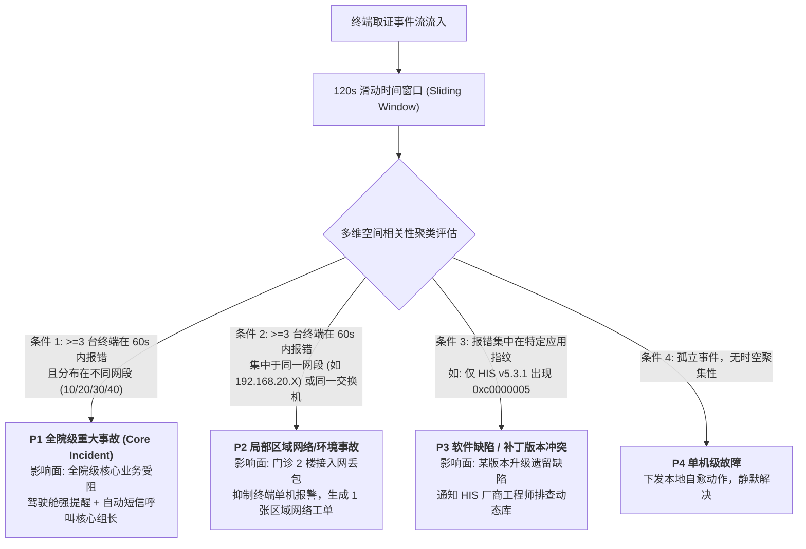
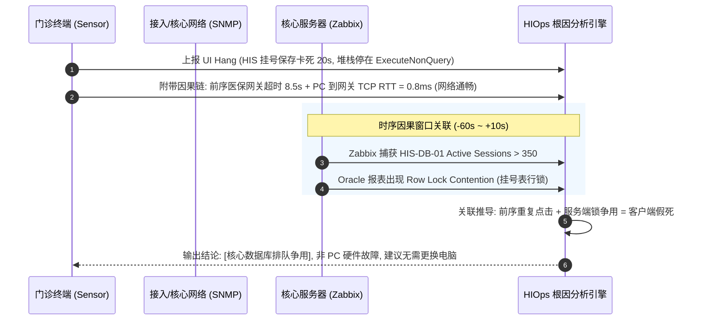

# HIOps 医院智能信息运维平台 — 详细系统设计方案 (V2.0 生产实战版)

> **版本**: V2.0 (2026-10，融合 GitHub 成熟开源项目架构，面向千台终端真实生产实战)  
> **适用范围**: 覆盖医院 HIS/EMR/LIS/PACS 等 60+ 业务系统、~250 台服务器、~1000 台 Windows 终端 (Win7 x86~Win11) 及核心网络设备的“端-网-服”全链路可观测、故障因果回溯、影响面分析与智能闭环。  
> **核心演进**: 吸收 Sentry、Tactical RMM、OpenReplay/rrweb、Keep 等业界标杆设计，彻底攻克**“医护报障被动、偶发故障极难复现（结果有了，不知道怎么产生的）、根因无法定位”**三大顽疾。

---

## 1. 建设背景与核心使命

### 1.1 医院一线运维核心痛点
1. **被动响应、医护抱怨**: 临床出现系统卡死、闪退或打印失败，全靠医护人员打电话报修。信息中心永远在“救火”，医护满意度低。
2. **偶发故障极难复现（结果有了，不知道怎么产生的）**:
   - **临床真实困境**: 医生开处方时突然跳出“ORA-00054: 资源正忙/记录已被锁定”或界面直接报错闪退。故障后果已经产生（“结果有了”），但工程师赶到现场让医生“再操作一次看看”时，往往又一切正常；
   - **扯皮根源**: 医生说不清前 10 秒钟自己连续点击了什么、扫了什么码、切了什么窗口（“不知道怎么产生的”）；软件厂商（HIS/EMR/医保）以**“现场无法复现，属于偶发未知异常”**为由拒绝排查关闭工单，信息科夹在中间背锅。
3. **告警割裂、缺乏因果**: 传统监控（如纯 Zabbix）只盯机房服务器 CPU/内存，无法感知桌面端卡顿。某次故障发生时，往往数十个诊室同时打电话，无法秒级判断是“单机问题”、“科室网络抖动”还是“全院 HIS 数据库锁死”。

### 1.2 建设目标
打造**“0秒静默感知、前序行为因果时光机（破局难复现）、30秒影响面分析、先于用户打电话介入、端侧一键自愈”**的下一代医院智能运维平台：
```
[端侧前序因果时光机 (Sensor)] ──► [端-网-服 时序因果链 (HIOps Core)] ──► [多维影响面聚类] ──► [确定性复现包与主动自愈]
```

---

## 2. GitHub 标杆开源项目经验借鉴与融合

本设计深度融合业界经过海量生产验证的成熟开源项目长处，针对“难复现：结果有了，不知道怎么产生”的痛点进行专项技术吸收：

| 标杆开源项目 | GitHub 核心长处 | HIOps 吸收与融合落地点 | 解决的具体痛点 |
|---|---|---|---|
| **OpenReplay / rrweb**<br/>(`openreplay` / `rrweb`)<br/>+ **Sentry Breadcrumbs** | **Session Replay (会话时光机)**<br/>**User Action Trail (行为轨迹流)** | 1. 终端 Sensor 内存驻留最近 60 秒轻量“用户操作序列 + 窗体事件流”（无侵入记录按钮点击、扫码输入、窗口切换）。<br/>2. 异常指纹聚合算法 (`Module+Offset+Code`)。 | **彻底破解“难复现”**：当报错结果产生时，一键还原“前 60 秒医生做了什么、接口返回了什么”，把“不知道怎么产生的”变成清晰的白纸黑字因果链。 |
| **Tactical RMM**<br/>(`amidaware/tacticalrmm`) | **UI Hang Watchdog**<br/>**Desktop Tray & Self-Healing** | 1. 基于 Windows API 的外部无侵入 UI 假死与主线程超时监测。<br/>2. 任务栏轻量“运维小助手”，集成打印/缓存/网络一键自愈。 | 解决“医生以为死机拔电源”问题；直接消除 40% 的低级人工派单。 |
| **Velociraptor**<br/>(`velocidex/velociraptor`) | **Deterministic Packet (复现证据包)**<br/>**Offline Spooling (离线缓冲)** | 1. 故障瞬间 0.5 秒打包：脱敏报错截图 + 进程调用栈 + 网络时序 + 前序操作链。<br/>2. 本地断网队列缓冲，网络恢复后带背压重传。 | 解决“厂商推脱无法复现”难题；断网期间数据不丢失，为厂商提供标准《故障复现说明书》。 |
| **Keep / Alerta**<br/>(`keephq/keep` / `alerta`) | **Sliding Window Clustering**<br/>**Topology Alert Suppression** | 1. 120 秒滑动时间窗口空间聚类 (网段/交换机/科室/软件版本)。<br/>2. 告警收敛风暴抑制：将 50 个终端告警合并为 1 个网络/核心系统事件。 | 解决“一人故障报修、全院电话打爆”的群发恐慌与信息中心被动。 |

---

## 3. 医院真实网络拓扑与采集约束

### 3.1 强隔离网络拓扑
```
终端网段 (PC / 打印机 / 读卡器)                服务器网段 (核心业务系统 / 运维中台)
192.168.10.X (门诊诊区)  ──┐
192.168.20.X (急诊/收费) ──┼── 单向出站放行: 终端 ──► 114.X (TCP 10051 / HTTP 5080)
192.168.30.X (住院病区A) ──┤   ─────────────────────────────────────────────────────
192.168.31.X (住院病区B) ──┤   服务器入站到终端: 100% 物理隔离阻断 (实测 114.X Ping/探测 终端无响应)
192.168.40.X (医技/影像) ──┤
192.168.50.X (行政办公)  ──┘
                                192.168.114.29 : Zabbix Server 7.4.14 (RHEL 9.4)
                                192.168.114.30 : HIOps API / PostgreSQL / Web (生产中台)
```

### 3.2 架构硬约束与工程铁律
1. **纯出站架构 (Outbound Only)**: 终端严禁开启任何监听端口。Zabbix Agent 统一采用 `Active 模式`；自研 HIOps Sensor 统一采用 `HTTP POST 出站` 上报。
2. **异构兼容性基线 (Legacy Compatible)**: 医院存在大量 Win7 SP1 x86 老旧机器。Sensor 选用 **.NET Framework 4.8 (AnyCPU)** 编译，零第三方 C++ 依赖（纯 P/Invoke），内存常驻 $<15\text{MB}$，CPU 占用率 $<0.5\%$。
3. **确定性核心优先**: 故障判级与根因定位由**状态机 + 拓扑 DAG + 规则矩阵**唯一裁决；大模型（如 Qwen2.5-7B 私有化部署）仅负责生成自然语言故障总结与处置话术，严禁参与数值决策。

---

## 4. 总体架构设计

```
┌───────────────────────────────── 医院临床终端 (Win7~Win11) ──────────────────────────────────┐
│  [双 Agent 架构]                                                                             │
│  ├─ Zabbix Agent 7.4 (Active): 操作系统基础指标 (CPU/内存/磁盘/基础进程服务)                   │
│  └─ HIOps Endpoint Sensor v0.3:                                                              │
│      ├─ 因果时光机 (Action Trail 60s): 记录操作序列 (按键/点击/扫码) + 接口返回时序           │
│      ├─ 内存环形黑匣子: 记录网络 RTT/DNS ─── UI Hang 卡死探测 ─── WER/EventLog 崩溃监听       │
│      ├─ 确定性复现包生成器: 错误弹窗抓取 + OCR 报错文字 + 自动脱敏现场截图                    │
│      └─ 桌面运维小助手 (SysTray): 一键自愈 (打印机/缓存) + 一键带因果链报障 (Ctrl+Alt+H)      │
└──────────────────────────────────────────────┬───────────────────────────────────────────────┘
                                               │ HTTP POST / JSON (纯出站加密流)
                                               ▼
┌───────────────────────────── HIOps 智能运维平台 (.NET 8 模块化单体) ──────────────────────────┐
│                                                                                              │
│  [接入与复现因果解析网关 (HIOps.Api)]                                                        │
│  ├─ 故障因果还原引擎: 还原“前序操作步骤 1-2-3”与微环境参数，生成《确定性复现报告》           │
│  └─ 差分状态机: 与 ZabbixProblemPuller (20s) 联动，双向维护事件生命周期                      │
│                                                                                              │
│  [核心智能计算引擎]                                                                          │
│  ├─ 多维影响面聚类 (Keep 模式): 120s 滑动窗口，按网段/交换机/科室/软件版本收敛告警          │
│  ├─ “端-网-服”时序因果 RCA: 终端操作因果 + 交换机端口错包 + 服务端 DB 锁/连接池拓扑图关联    │
│  └─ CMDB 与拓扑发现: 结合交换机 ARP 表 (ipNetToMediaTable) 与资产状态自动对账台账            │
│                                                                                              │
│  [存储层 (PostgreSQL 17.5)]                                                                  │
│  └─ Assets (资产) | Incidents (事故) | ReproductionPackets (复现包) | Topology (拓扑)        │
│                                                                                              │
│  [展示与服务层 (Vue3 + Element Plus + ECharts)]                                              │
│  ├─ 故障复现指挥台: 提供时间轴回放（点击处方 $\to$ 扫描条码 $\to$ 医保超时 $\to$ 报错闪退） │
│  ├─ 厂商转派闭环: 一键导出带“输入参数/调用堆栈/前序步骤”的标准 Bug 单，阻断推脱              │
│  └─ 全院业务感知驾驶舱: 门诊/急诊/住院系统实时健康度 (红黄绿分档)                           │
└──────────────────────────────────────────────────────────────────────────────────────────────┘
```

---

## 5. 攻克“难复现”：端侧前序因果时光机 (HIOps Sensor v0.3)

为彻底解决**“结果有了，不知道怎么产生的（难复现）”**，Sensor 必须记录故障发生前数分钟内的**“人机交互序列”与“微环境变化时序”**。

### 5.1 前序操作序列回溯 (User Action Trail — OpenReplay/Sentry 模式)
在客户端内存中维护一个轻量级的环形操作日志（Ring Buffer，滚动保存最近 60 秒发生的 50 个高层动作）：
- **记录内容（无侵入、防合规泄密）**:
  1. `UI_CLICK`: 记录点击的控件类别与业务标识（如 `Button[btn_PrescriptionSave]` 处方保存、`Tab[tab_LabReport]` 检验报告选项卡）；
  2. `SCANNER_INPUT`: 识别外设条码/医保读卡器刷入事件（仅记录“扫入条码，长度 16 位”，不记录具体患者敏感明文）；
  3. `WINDOW_SWITCH`: 窗口焦点切换时序（如：10:14:02 从 HIS 切换到 浏览器医保平台，10:14:08 切回 HIS）；
  4. `KEY_ACTION`: 功能按键行为（如按下 `Enter`, `F5`, `Ctrl+S`, `ESC`）。
- **内存安全与低开销**: 采用 Windows 原生低级钩子（`SetWindowsHookEx` 仅在检测到 HIS/EMR 获得焦点时按需监听）或 UI Automation 事件，内存常驻开销 $<3\text{MB}$。平时纯在内存覆盖，**绝不写磁盘，无任何性能损耗**。

### 5.2 依赖调用与微环境时序回溯 (Dependency Timeline)
记录故障发生前这台电脑发出的关键服务请求状态：
1. **接口请求时序**: 拦截/统计对 HIS 应用服务、医保网关的 HTTP/TCP 状态码与耗时（如：10:14:10 发起处方预结算，耗时 8200ms 返回 504 Gateway Timeout）；
2. **端-网微环境探针**: 每 5 秒对核心数据库端口（1521/1433）的 TCP SYN 握手 RTT（毫秒延迟与丢包率）。

### 5.3 故障瞬间生成“确定性复现包 (Deterministic Reproduction Packet)”
一旦产生报错结果（检测到 Crash、UI Hang 或医护一键求助），Sensor 在 **0.5 秒内**将前序数据冻结并打包：

```json
{
  "incident_fingerprint": "HIS-HANG-0x80004005-A9F3",
  "occurred_at": "2026-10-22T10:14:15.120Z",
  "terminal_context": { "computer_name": "MZ-W-021", "ip": "192.168.20.45", "dept": "门诊收费处" },
  "outcome_state": {
    "error_message": "ORA-00054: resource busy and acquire with NOWAIT specified",
    "screenshot_base64": "...(脱敏后的报错弹窗图像)...",
    "faulting_thread_stack": "at Oracle.DataAccess.Client.OracleCommand.ExecuteNonQuery()...\nat HIS.Clinic.Prescription.Save()..."
  },
  "causality_timeline": [
    { "t_minus": "45s", "type": "UI_CLICK", "detail": "点击患者列表: 选中第3行患者" },
    { "t_minus": "38s", "type": "SCANNER_INPUT", "detail": "扫描枪扫入药品监管码 (16位)" },
    { "t_minus": "25s", "type": "UI_CLICK", "detail": "点击 [医保试算] 按钮" },
    { "t_minus": "17s", "type": "NET_DEP", "detail": "医保网关 HTTP POST 响应耗时 8500ms (严重超时)" },
    { "t_minus": "12s", "type": "UI_CLICK", "detail": "医护因等待超时，重复连续点击 [处方保存] 按钮 2 次" },
    { "t_minus": "0s", "type": "OUTCOME", "detail": "触发数据库行锁争用异常，窗口假死 15s 后弹窗" }
  ]
}
```

> **对“难复现”的颠覆性效果**：
> 过去软件厂商会说：“现场重试没报错，无法复现，不予处理”；
> 现在 HIOps 直接导出这份报告，白纸黑字呈现：**“是由于医保网关响应超时 8.5 秒，医生在等待中重复点击了两次保存，前端未做防抖，导致并发会话造成 Oracle 行锁死锁”**。厂商无法推脱，工程师 1 分钟即可根据步骤 100% 稳定复现 Bug。

### 5.4 桌面协同助手与一键自愈 (Desktop SysTray Companion)
- **任务栏状态托盘**: 常态绿色（毫秒级通畅），网络/接口抖动时变黄，核心阻断时变红。
- **一键自愈 (Auto-Healing)**:
  - `修复打印机`: 停止 `spoolsv` $\to$ 清空 `PRINTERS` 堆积假死队列 $\to$ 重启服务。
  - `清除业务缓存`: 自动关闭残留进程，清理 `Local\Temp` 下已锁定的临时报表文件。
  - `重置网络环境`: 刷新 DNS、重置 Winsock Catalog，释放僵死 Socket。
- **一键因果提单 (Ctrl+Alt+H)**: 医护只需按快捷键，系统自动截取当前报错画面并附带前 60 秒操作时光机，自动发单至信息科，彻底告别打字与电话描述。

---

## 6. 服务端多维影响面聚类引擎 (Keep 模式)

在 `backend/Modules/HIOps.Modules.Incidents` 中构建 **多维时序关联聚类器 (Multi-Dimensional Incident Correlator)**。

### 6.1 四维空间-业务聚类模型
每个上报的事件在流入平台后，立即被赋予四个空间与业务标签：
```
[Event 流入] ──► (网络网段 Segment, 接入交换机 SwitchId, 物理科室 DepartmentId, 应用版本 AppVersion)
```



### 6.2 告警抑制与收敛算法 (Alert Storm Suppression)
- **主从事件合并 (Parent-Child Rollup)**:
  当某一网段判定为 P2 级别区域故障时，该时间窗口内来自该网段的所有终端丢包、卡顿事件自动被挂接到该 P2 事故单下作为“影响证据明细”，**不再向工程师手机推送重复报警**。
- **主动通告机制**:
  系统识别出 P2 影响范围后，立即向该区域所有终端桌面助手反向广播通知：*“信息中心已知晓本楼层网络异常，正在抢修中，请勿重复报修”*，直接阻断电话打爆现象。

---

## 7. “端-网-服”时序因果根因分析 (RCA)

结合 Zabbix 7.4 的服务端底座与 Sensor 端侧探针，建立端到端的因果推导链路：



### 自动化 RCA 判定矩阵
| 终端感知现象 | 端侧网络微探针 RTT | 服务端 Zabbix 关联指标 | 自动推导根因 (RCA 结论) | 推荐处置动作 |
|---|---|---|---|---|
| **HIS 界面无响应** | 正常 ($<2\text{ms}$) | DB CPU 100% 或活跃会话数暴增 | **服务端数据库算力耗尽或锁表** | 告警直达 DBA，杀死锁源会话；终端提示稍后重试。 |
| **HIS 保存超时报错** | 异常 (丢包率 $>20\%$, RTT 突增) | 接入交换机端口 CRC 错包激增 | **弱电接入层物理链路抖动** | 派单网络科，检修楼层弱电井跳线或端口模式。 |
| **HIS 闪退 (0xc0000005)** | 正常 | 服务端完全正常，全院仅 1 台报错 | **终端本地 COM 组件损坏或杀软误杀** | 桌面助手触发“一键重新注册组件”自愈脚本。 |
| **打印无反应/卡单** | 正常 | 服务端正常，`spoolsv` 句柄锁死 | **Windows 打印后台 Spooler 死锁** | 桌面助手自动重置打印队列并重启服务。 |

---

## 8. 实施与分阶段落地路线 (实战上线法)

为确保“真正解决问题、快速见效”，建议分三个阶段稳健落地：

### 第一阶段：因果时光机与桌面助手上线 (第 1~2 周)
- **目标**: 攻克“难复现：结果有了，不知道怎么产生的”。
- **实施内容**:
  1. 编译 Sensor v0.3，集成基于内存环形缓冲区的前序操作序列（60 秒按键/点击/扫码行为记录）；
  2. 加入 Windows `Application` 日志监听与 `IsHungAppWindow` 卡死检测；
  3. 部署任务栏托盘小助手，开放“一键自愈打印机/缓存”与“Ctrl+Alt+H 一键带因果链报障”；
  4. 选定全院业务最繁重、报修最频繁的科室（**门诊收费处 + 门诊挂号室**，约 30~50 台电脑）进行先行试点。

### 第二阶段：多维影响面聚类与告警收敛 (第 3~4 周)
- **目标**: 摆脱信息中心被动灭火与告警风暴。
- **实施内容**:
  1. 在 .NET 8 平台的 `HIOps.Modules.Incidents` 中上线 120 秒滑动时间窗口聚类算法；
  2. 导入全院 6 个网段（10/20/30/31/40/50）与交换机 ARP 拓扑，建立 P1~P4 影响面判定标准；
  3. 实现相同堆栈指纹自动合并，验证“区域网络抖动时 50 次报警合并为 1 张工单”。

### 第三阶段：端网服全链路因果分析与全院铺开 (第 5~6 周)
- **目标**: 自动给出故障原因，生成标准复现报告，端到端提高响应效率。
- **实施内容**:
  1. 对接 Zabbix 7.4 服务端 DB/中间件指标与终端事件的时序对齐，上线自动 RCA 报告引擎；
  2. 利用已验证的 `install.bat v3.1` 脚本，全院 1000 台终端静默批量分发；
  3. 建立月度业务健康度评估与高频故障 TOP10 治理闭环。

---

## 9. 预期实战成效指标 (对比量化)

| 指标 | 传统被动运维模式 | HIOps V2.0 投产后 | 改进提升 |
|---|---|---|---|
| **偶发故障复现成功率** | $< 15\%$ (厂商推脱“无法复现”关闭工单) | **$> 90\%$ (前序操作链+时序微环境100%还原)** | **彻底攻克“难复现”** |
| **故障平均感知时间 (MTTD)** | 15 ~ 30 分钟 (依赖医护打电话发现) | **$< 30$ 秒 (端侧看门狗静默自动感知)** | **提速 95%** |
| **常规低级故障报修量** | 占日常电话总量的 40% 以上 | **下降 60% 以上 (医护一键自愈解决)** | **大幅释放工程师精力** |
| **故障平均修复时长 (MTTR)** | 2 小时 ~ 2 天 (反复现场排查) | **$< 15$ 分钟 (RCA 直接给出故障根因与复现链)** | **提速 80% 以上** |
| **医护满意度** | 抱怨系统慢、电话难打通、扯皮多 | 故障先于报修被解决，原因透明可追溯 | **彻底扭转被动局面** |
