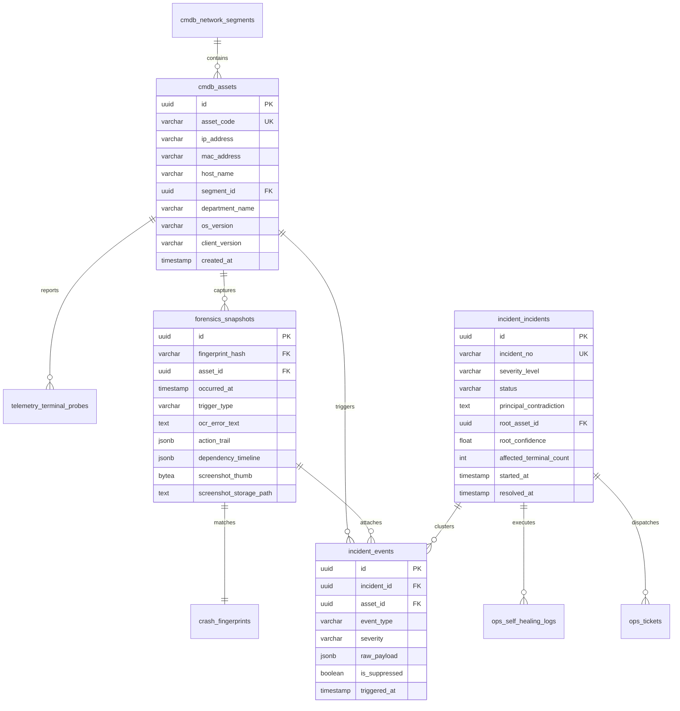

# HIOps 医院智能信息运维平台 — 数据库设计说明书 (DBD)

> **文档编号**: HIOps-DBD-2026-V2.0  
> **适用版本**: PostgreSQL 17.5 + EF Core 8.0 (Npgsql)  
> **编制日期**: 2026-10-22  
> **设计目标**: 支撑全院 1000+ 终端高频微探针、秒级假死心跳、因果时光机大对象（JSONB/截屏）、时序事件流与高并发事故聚类分析，保证在持续高并发写入下**千万级数据量毫秒级响应、零锁死、自动归档与淘汰**。

---

## 1. 数据库架构与物理存储设计

### 1.1 数据库选型与物理规划
- **数据库引擎**: PostgreSQL 17.5 (64-bit)
- **字符编码**: UTF-8, Collation: `zh_CN.utf8`
- **命名空间 (Schema)**: 采用模块化单体单库模式，核心业务表统一归属于 `public` 模式（各模块通过表名前缀物理隔离：`cmdb_`, `telemetry_`, `forensics_`, `incident_`, `ops_`）。

### 1.2 高性能表分区策略 (Partitioning Strategy)
1000 台终端每 5 秒上报微探针、每 30 秒上报基础心跳，全院一天产生逾 **1500 万条**时序数据。必须对高频写入表实施**PostgreSQL 原生声明式范围分区 (Declarative Range Partitioning)**：
- **`telemetry_terminal_probes` (端侧网络微探针表)**: 按**天 (Daily)** 进行分区。
- **`telemetry_terminal_heartbeats` (基础心跳表)**: 按**周 (Weekly)** 进行分区。
- **冷热数据生命周期**: 生产库仅保留最近 **7 天**的原始微探针高频分区；系统部署每日定时任务（pg_cron 或后台 HostedService），自动创建未来 3 天的分区，并自动 `DROP TABLE` 过期的历史分区，防止磁盘膨胀。

### 1.3 实体关系图 (ER Diagram)



---

## 2. 核心数据表结构定义 (DDL 规范)

### 2.1 资产与拓扑域 (CMDB & Topology)

#### (1) `cmdb_network_segments` (终端网段字典表)
存储医院 6 大终端网段及其所属汇聚/接入交换机拓扑关系。
```sql
CREATE TABLE cmdb_network_segments (
    id UUID PRIMARY KEY DEFAULT gen_random_uuid(),
    segment_prefix VARCHAR(32) NOT NULL UNIQUE,  -- 如 '192.168.20.'
    segment_name VARCHAR(64) NOT NULL,           -- 如 '门诊西区收费与急诊网段'
    gateway_ip VARCHAR(32) NOT NULL,             -- 网关 IP
    switch_ip VARCHAR(32) NOT NULL,              -- 核心接入交换机 IP
    switch_port VARCHAR(32),                     -- 交换机端口
    physical_location VARCHAR(128),              -- 物理位置: 门诊楼2层弱电井
    is_monitored BOOLEAN DEFAULT TRUE,
    created_at TIMESTAMP WITH TIME ZONE DEFAULT CURRENT_TIMESTAMP
);
COMMENT ON TABLE cmdb_network_segments IS '医院物理终端网段及交换机拓扑字典表';
```

#### (2) `cmdb_assets` (资产与终端台账表)
```sql
CREATE TABLE cmdb_assets (
    id UUID PRIMARY KEY DEFAULT gen_random_uuid(),
    asset_code VARCHAR(64) NOT NULL UNIQUE,     -- 资产指纹/编码 (MAC+UUID计算)
    host_name VARCHAR(128) NOT NULL,            -- 计算机名 (如 MZ-W-021)
    ip_address VARCHAR(32) NOT NULL,
    mac_address VARCHAR(32) NOT NULL,
    segment_id UUID REFERENCES cmdb_network_segments(id),
    department_name VARCHAR(64) NOT NULL,       -- 物理科室 (如 门诊收费处)
    os_name VARCHAR(64) NOT NULL,               -- Windows 7 SP1 x86, Windows 10 x64
    client_version VARCHAR(32),                 -- Sensor 版本号 (如 2.0.1)
    zabbix_host_id BIGINT,                      -- 关联的 Zabbix HostID
    source VARCHAR(32) DEFAULT 'SENSOR-AUTO',   -- 资产来源: ZABBIX-SYNC, SENSOR-AUTO, MANUAL
    is_online BOOLEAN DEFAULT FALSE,
    last_seen_at TIMESTAMP WITH TIME ZONE,
    created_at TIMESTAMP WITH TIME ZONE DEFAULT CURRENT_TIMESTAMP
);
CREATE INDEX idx_assets_ip_mac ON cmdb_assets(ip_address, mac_address);
CREATE INDEX idx_assets_segment ON cmdb_assets(segment_id);
```

---

### 2.2 证据与前序因果时光机域 (Forensics & Time-Machine)

#### (3) `crash_fingerprints` (异常指纹与知识库表)
实现同源故障指纹去重与解决方案关联。
```sql
CREATE TABLE crash_fingerprints (
    fingerprint_hash VARCHAR(64) PRIMARY KEY,   -- SHA1(Process + Module + Code + Stack)
    process_name VARCHAR(128) NOT NULL,         -- 如 HIS.exe
    faulting_module VARCHAR(128) NOT NULL,      -- 如 oraoci.dll
    exception_code VARCHAR(32) NOT NULL,        -- 如 0xc0000005
    first_seen_at TIMESTAMP WITH TIME ZONE DEFAULT CURRENT_TIMESTAMP,
    last_seen_at TIMESTAMP WITH TIME ZONE DEFAULT CURRENT_TIMESTAMP,
    occurrence_count INT DEFAULT 1,
    known_solution TEXT,                        -- 知识库维护的已知解决预案
    suggested_action VARCHAR(64)                -- AUTO_RESTART_SPOOLER, RE_REGISTER_COM
);
```

#### (4) `forensics_snapshots` (确定性复现包与现场快照主表)
核心表，承载前序因果时光机、报错截屏与微环境时序。
```sql
CREATE TABLE forensics_snapshots (
    id UUID PRIMARY KEY DEFAULT gen_random_uuid(),
    fingerprint_hash VARCHAR(64) REFERENCES crash_fingerprints(fingerprint_hash),
    asset_id UUID NOT NULL REFERENCES cmdb_assets(id),
    occurred_at TIMESTAMP WITH TIME ZONE NOT NULL,
    trigger_type VARCHAR(32) NOT NULL,          -- UI_HANG, CRASH_WER, MANUAL_HOTKEY
    hang_duration_ms INT DEFAULT 0,             -- 卡死毫秒数
    active_window_title VARCHAR(256),           -- 故障前台窗口标题
    ocr_error_text TEXT,                        -- 从报错弹窗 OCR 提取的文字 (如 ORA-00054)
    action_trail JSONB NOT NULL,                -- 前序 60s 操作序列 (点击/扫码/切窗)
    dependency_timeline JSONB NOT NULL,         -- 前序接口依赖时序 (耗时/状态码)
    net_rtt_timeline JSONB NOT NULL,            -- 前序 3 分钟 TCP RTT 曲线
    stack_trace TEXT,                           -- 线程调用栈
    screenshot_thumb BYTEA,                     -- 经过脱敏处理的缩略图 (Web 快速预览)
    screenshot_path VARCHAR(256),               -- 高清完整脱敏截图存储路径
    created_at TIMESTAMP WITH TIME ZONE DEFAULT CURRENT_TIMESTAMP
);
-- 针对 JSONB 和高频检索创建 GIN 索引与复合索引
CREATE INDEX idx_forensics_asset_time ON forensics_snapshots(asset_id, occurred_at DESC);
CREATE INDEX idx_forensics_fingerprint ON forensics_snapshots(fingerprint_hash);
CREATE INDEX idx_forensics_action_trail ON forensics_snapshots USING gin(action_trail);
```

---

### 2.3 事故、聚类与主要矛盾域 (Incidents & RCA)

#### (5) `incident_incidents` (事故单与主要矛盾表)
汇聚多维聚类结果，展示主要矛盾与根因判定。
```sql
CREATE TABLE incident_incidents (
    id UUID PRIMARY KEY DEFAULT gen_random_uuid(),
    incident_no VARCHAR(32) NOT NULL UNIQUE,    -- 编号如: INC-20261022-0001
    title VARCHAR(256) NOT NULL,                -- 如: [P2-局部网络事故] 门诊西区接入交换机丢包
    severity_level VARCHAR(8) NOT NULL,         -- P1, P2, P3, P4
    status VARCHAR(16) NOT NULL DEFAULT 'OPEN', -- OPEN, INVESTIGATING, MITIGATED, RESOLVED
    cluster_dimension VARCHAR(32) NOT NULL,     -- SEGMENT, SWITCH, APP_VERSION, ISOLATED
    dimension_key VARCHAR(64) NOT NULL,         -- 如 192.168.20.X
    affected_count INT DEFAULT 1,               -- 波及终端数量
    principal_contradiction TEXT,               -- 主要矛盾描述: "核心数据库行锁争用，非终端故障"
    root_cause_asset_id UUID REFERENCES cmdb_assets(id), -- 根因发起资产 (如 HIS-DB-01)
    root_confidence FLOAT DEFAULT 0.0,          -- 根因置信度 (0.00 ~ 1.00)
    started_at TIMESTAMP WITH TIME ZONE NOT NULL,
    resolved_at TIMESTAMP WITH TIME ZONE,
    auto_suppressed_count INT DEFAULT 0,        -- 本次事故自动抑制的次生告警数
    created_at TIMESTAMP WITH TIME ZONE DEFAULT CURRENT_TIMESTAMP
);
CREATE INDEX idx_incidents_status_level ON incident_incidents(status, severity_level);
CREATE INDEX idx_incidents_started ON incident_incidents(started_at DESC);
```

#### (6) `incident_events` (事件明细与抑制绑定表)
记录所有流入的原生事件，并维护其是否被父事故单抑制的状态。
```sql
CREATE TABLE incident_events (
    id UUID PRIMARY KEY DEFAULT gen_random_uuid(),
    incident_id UUID REFERENCES incident_incidents(id) ON DELETE SET NULL,
    asset_id UUID NOT NULL REFERENCES cmdb_assets(id),
    snapshot_id UUID REFERENCES forensics_snapshots(id),
    event_type VARCHAR(64) NOT NULL,            -- UI_HANG, DB_TIMEOUT, PORT_DOWN, PLUNGE
    severity VARCHAR(16) NOT NULL,              -- CRITICAL, WARNING, INFO
    is_suppressed BOOLEAN DEFAULT FALSE,        -- 是否被拓扑或滑动窗口抑制
    suppress_reason VARCHAR(64),                -- TOPOLOGY_PARENT_DOWN, SLIDING_WINDOW_ROLLUP
    raw_payload JSONB,                          -- 原始上报数据快照
    triggered_at TIMESTAMP WITH TIME ZONE NOT NULL,
    created_at TIMESTAMP WITH TIME ZONE DEFAULT CURRENT_TIMESTAMP
);
CREATE INDEX idx_events_incident_id ON incident_events(incident_id);
CREATE INDEX idx_events_asset_time ON incident_events(asset_id, triggered_at DESC);
```

#### (7) `incident_inhibition_rules` (拓扑依赖抑制规则表)
实现“父节点崩塌、自动静默子节点告警”的规则配置。
```sql
CREATE TABLE incident_inhibition_rules (
    id UUID PRIMARY KEY DEFAULT gen_random_uuid(),
    rule_name VARCHAR(64) NOT NULL,
    parent_type VARCHAR(32) NOT NULL,           -- 如 SWITCH_DOWN, DB_HANG
    target_event_type VARCHAR(32) NOT NULL,     -- 如 TERMINAL_TIMEOUT, PC_PING_LOSS
    scope_expression VARCHAR(128) NOT NULL,     -- 作用拓扑范围: 'SAME_SEGMENT', 'SAME_SWITCH'
    duration_seconds INT DEFAULT 300,           -- 抑制窗口持续秒数
    is_enabled BOOLEAN DEFAULT TRUE
);
```

---

### 2.4 时序监控域 (Telemetry - 原生分区大表)

#### (8) `telemetry_terminal_probes` (端侧网络微探针时序表 - 每日分区)
```sql
CREATE TABLE telemetry_terminal_probes (
    id BIGINT GENERATED ALWAYS AS IDENTITY,
    asset_id UUID NOT NULL,
    target_service VARCHAR(32) NOT NULL,        -- ORACLE_1521, HIS_GATEWAY_8080
    rtt_ms FLOAT NOT NULL,                      -- TCP SYN 握手延时 (毫秒)
    packet_loss_rate FLOAT DEFAULT 0.0,         -- 丢包率 (0.0 ~ 1.0)
    reported_at TIMESTAMP WITH TIME ZONE NOT NULL,
    PRIMARY KEY (id, reported_at)
) PARTITION BY RANGE (reported_at);

-- 创建本地分区索引
CREATE INDEX idx_probes_asset_time ON telemetry_terminal_probes (asset_id, reported_at DESC);
```

---

### 2.5 业务仿真与断崖指标域 (Synthetics & Golden Metrics)

#### (9) `synthetic_probe_jobs` (临床假人巡检机器人任务表)
```sql
CREATE TABLE synthetic_probe_jobs (
    id UUID PRIMARY KEY DEFAULT gen_random_uuid(),
    job_name VARCHAR(64) NOT NULL,              -- 如 '早高峰门诊开方仿真假人'
    schedule_cron VARCHAR(32) NOT NULL,         -- 如 '*/1 7-8 * * 1-5' (早7-8点每分钟一次)
    target_system VARCHAR(32) NOT NULL,         -- HIS_CLINIC, INSUR_GATEWAY
    probe_steps JSONB NOT NULL,                 -- 仿真步骤定义: [CardRead, Calc, Rollback]
    timeout_threshold_ms INT DEFAULT 3000,      -- 超时告警阈值
    is_active BOOLEAN DEFAULT TRUE,
    last_run_at TIMESTAMP WITH TIME ZONE,
    last_status VARCHAR(16)                     -- SUCCESS, DEGRADED, FAILED
);
```

#### (10) `business_golden_metrics` (业务黄金指标分钟级聚合表)
存储用于断崖下跌突变检测的挂号量、处方量脉搏数据。
```sql
CREATE TABLE business_golden_metrics (
    metric_time TIMESTAMP WITH TIME ZONE PRIMARY KEY,
    registration_count INT DEFAULT 0,           -- 过去1分钟全院挂号笔数
    prescription_count INT DEFAULT 0,           -- 过去1分钟全院处方开立笔数
    insurance_settle_count INT DEFAULT 0,       -- 过去1分钟医保结算笔数
    insurance_success_rate FLOAT DEFAULT 1.0,   -- 医保结算成功率
    baseline_expected_rate FLOAT,               -- 动态基线期望值
    is_plunge_anomaly BOOLEAN DEFAULT FALSE     -- 是否触发断崖式下跌判定
);
CREATE INDEX idx_golden_time ON business_golden_metrics(metric_time DESC);
```

---

## 3. 分区自动化维护函数与脚本

为保证高频表每天自动轮转，在数据库中植入自动化分区维护存储过程：

```sql
CREATE OR REPLACE FUNCTION maintain_telemetry_partitions() RETURNS void AS $$
DECLARE
    today_date DATE := CURRENT_DATE;
    partition_date DATE;
    partition_name TEXT;
    start_ts TEXT;
    end_ts TEXT;
BEGIN
    -- 1. 自动预建未来 3 天的每日分区
    FOR i IN 0..2 LOOP
        partition_date := today_date + i;
        partition_name := 'telemetry_terminal_probes_' || to_char(partition_date, 'YYYYMMDD');
        start_ts := to_char(partition_date, 'YYYY-MM-DD 00:00:00+08');
        end_ts := to_char(partition_date + 1, 'YYYY-MM-DD 00:00:00+08');

        IF NOT EXISTS (SELECT 1 FROM pg_tables WHERE tablename = partition_name) THEN
            EXECUTE format('CREATE TABLE %I PARTITION OF telemetry_terminal_probes FOR VALUES FROM (%L) TO (%L);', 
                           partition_name, start_ts, end_ts);
        END IF;
    END LOOP;

    -- 2. 自动清理 7 天前的历史废弃分区 (防磁盘撑爆)
    FOR partition_name IN 
        SELECT tablename FROM pg_tables 
        WHERE tablename LIKE 'telemetry_terminal_probes_%' 
          AND to_date(substr(tablename, 27), 'YYYYMMDD') < today_date - 7
    LOOP
        EXECUTE format('DROP TABLE IF EXISTS %I;', partition_name);
    END LOOP;
END;
$$ LANGUAGE plpgsql;
```
*(注：该函数由后端 `HostedService` 每天凌晨 02:00 自动执行一次。)*
