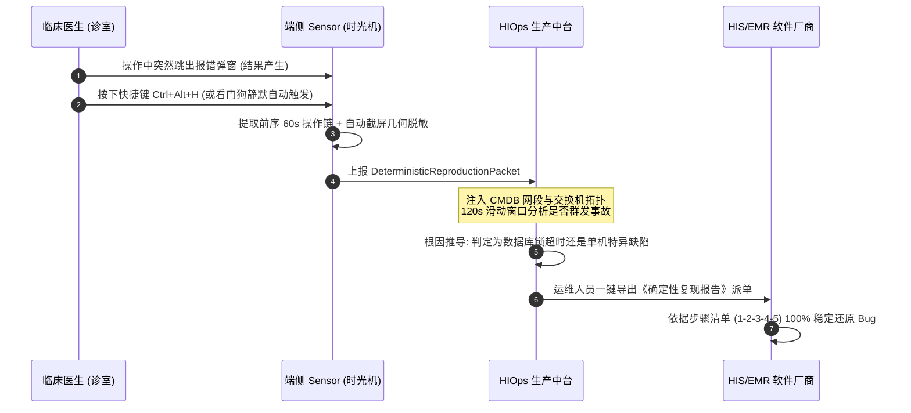

# HIOps 医院智能信息运维平台 — 用户操作与管理手册 (V2.0 生产实战版)

> **文档版本**: V2.0  
> **适用系统**: HIOps 医院智能信息运维平台 (生产基线: 192.168.114.30:5080)  
> **适用对象**: 医院信息中心主任、系统工程师、网络工程师、桌面运维人员、临床科室信息员及第三方厂商工程师  
> **文档定位**: 系统全生命周期的操作指导手册，覆盖「服务端管理控制台」、「终端探针看护与自愈」、「奇安信桌管批量下发」及「故障复现与 RCA 根因闭环」。

---

## 目录
1. [系统概述与架构拓扑](#1-系统概述与架构拓扑)
2. [快速入门与登录接入](#2-快速入门与登录接入)
3. [服务端管理控制台核心功能指南](#3-服务端管理控制台核心功能指南)
   - 3.1 [运行驾驶舱 (Dashboard)](#31-运行驾驶舱-dashboard)
   - 3.2 [探针看护 · 终端画像 (Agent Health)](#32-探针看护--终端画像-agent-health)
   - 3.3 [资产中心与 CMDB (Assets)](#33-资产中心与-cmdb-assets)
   - 3.4 [拓扑中心 (网络/虚拟化/业务拓扑与图谱)](#34-拓扑中心-网络虚拟化业务拓扑与图谱)
   - 3.5 [监控告警与探针覆盖 (Monitor)](#35-监控告警与探针覆盖-monitor)
   - 3.6 [患者数据安全与合规审计 (DLP)](#36-患者数据安全与合规审计-dlp)
4. [终端探针 (Endpoint Sensor) 部署与使用指南](#4-终端探针-endpoint-sensor-部署与使用指南)
   - 4.1 [奇安信天擎/桌管软件批量静默下发 (推荐)](#41-奇安信天擎桌管软件批量静默下发-推荐)
   - 4.2 [绿色单机解压与脚本安装 (备用)](#42-绿色单机解压与脚本安装-备用)
   - 4.3 [临床桌面运维小助手与快捷键取证 (Ctrl+Alt+H)](#43-临床桌面运维小助手与快捷键取证-ctrlalth)
5. [偶发故障确定性复现与 RCA 闭环操作](#5-偶发故障确定性复现与-rca-闭环操作)
6. [日常维护与常见问题 (FAQ)](#6-日常维护与常见问题-faq)

---

## 1. 系统概述与架构拓扑

HIOps 专为大型综合医院复杂的“端-网-服”异构环境打造，旨在彻底攻克传统运维中**“医护被动报修、偶发卡死极难复现（结果有了不知道怎么产生的）、厂商推诿扯皮、告警风暴”**四大痛点。

### 1.1 系统物理部署基线
```
┌───────────────────────────────── 医院临床终端网段 ─────────────────────────────────┐
│ 192.168.10.X (门诊诊区)    192.168.20.X (急诊/收费处)    192.168.30.X (住院病区)    │
│ 192.168.31.X (外科病区)    192.168.40.X (医技/影像)      192.168.50.X (行政办公)    │
│                                                                                     │
│ 运行: HIOps Endpoint Sensor (Win7 x86~Win11) ─── 仅单向出站 ───┐                     │
└────────────────────────────────────────────────────────────────┼────────────────────┘
                                                                 │ HTTP 5080 / TCP 10051
                                                                 ▼
┌──────────────────────────────── 医院机房核心中台 ───────────────────────────────────┐
│                                                                                     │
│  【HIOps 生产服务器】 192.168.114.30                                                  │
│   ├── 生产核心服务: 端口 5080 (http://192.168.114.30:5080)                          │
│   ├── Docker 验证环境: 端口 5081 (http://192.168.114.30:5081)                       │
│   └── 生产数据库: PostgreSQL 17 (127.0.0.1:5432 / hiops 库)                          │
│                                                                                     │
│  【Zabbix 底座服务器】 192.168.114.29                                                 │
│   ├── Web 界面与 API: http://192.168.114.29/zabbix/api_jsonrpc.php                  │
│   ├── Zabbix Server 守护进程: 端口 10051 (纳管 105 台受控主机)                       │
│   └── 数据库: MySQL 8.0 (zabbix 库)                                                 │
└─────────────────────────────────────────────────────────────────────────────────────┘
```

---

## 2. 快速入门与登录接入

### 2.1 浏览器要求与环境建议
- **推荐浏览器**: Google Chrome、Microsoft Edge、Firefox（建议使用 1920×1080 以上高分辨率显示器以获最佳拓扑图体验）。
- **客户端免插件**: 采用 Vue3 + Element Plus + SVG 纯前端渲染，无需安装任何 ActiveX 或 Flash 插件。

### 2.2 平台登录
1. 打开浏览器，在地址栏输入平台访问基地址：
   - **生产正式环境**: [`http://192.168.114.30:5080`](http://192.168.114.30:5080)
   - **Docker 备用/演练环境**: [`http://192.168.114.30:5081`](http://192.168.114.30:5081)
2. 在系统登录页输入管理员凭据：
   - **用户名**: `admin`
   - **默认密码**: `Admin@123`
3. 点击 **【登录】** 按钮，验证成功后系统将自动重定向至「运行驾驶舱」主页面。

> [!TIP]
> 如果您刚刚部署或升级了前端静态资源，请在浏览器中按下 **`Ctrl + F5`** 强制清空本地缓存刷新，以确保侧边栏菜单呈现最新版本规范。

---

## 3. 服务端管理控制台核心功能指南

系统左侧导航栏按照医院信息运维工作流精心规划为 7 大功能中心：

```
[HIOps 控制台导航架构]
├── 运行驾驶舱 (/dashboard)
├── 资产中心 (/assets)
├── 拓扑中心
│   ├── 网络拓扑 (/topology/network)
│   ├── 虚拟化拓扑 (/topology/virtualization)
│   ├── 业务拓扑 (/business)
│   └── 业务图谱 (/business/graph)
├── 探针看护
│   └── 终端画像 (/observe/health)   <-- 终端实时心跳与健康分析核心
├── 生命周期 (/lifecycle)
├── 监控告警
│   ├── 告警中心 (/monitor/incidents)
│   ├── 日志聚类 (/monitor/logs)
│   ├── 变更记录 (/monitor/changes)
│   ├── 探针覆盖 (/monitor/coverage)
│   └── 网络侧发现 (/monitor/network)
└── 患者数据安全 (/security/dlp)
```

---

### 3.1 运行驾驶舱 (Dashboard)
- **访问入口**: 左侧菜单第一项 **「运行驾驶舱」**（或直接访问 `/#/dashboard`）。
- **页面功能**:
  1. **全院业务健康指数**: 实时大屏呈现门诊收费、门诊医生站、住院护士站、PACS 影像系统的综合健康分（绿/黄/红三色预警）。
  2. **核心基础设施看板**: 联动展示核心数据库会话数、锁等待数量、核心接入交换机端口丢包率。
  3. **今日事故与工单分布**: 统计 24 小时内由系统自动聚类的重大事故（P1/P2/P3/P4 级）及当前闭环处置率。

---

### 3.2 探针看护 · 终端画像 (Agent Health)
本功能是全院终端可观测体系的**核心指挥中枢**，直接反映全院所有安装了 HIOps 探针的 PC 实时运行质态。

- **访问入口**: 左侧菜单 **「探针看护」** ➡️ **「终端画像」**（URL: `/#/observe/health`）。
- **界面核心板块**:
  1. **状态统计与快速筛选**:
     - 顶部卡片展示当前：**在线终端总数**、**离线终端总数**。
     - **状态按钮**: 支持一键切换【全部】、【在线】、【离线】终端。
     - **搜索过滤**: 支持在右上角输入【主机名 / IP】（如输入 `192.168.20.168` 或 `XXK007`）并回车快速定位。
  2. **终端台账与健康列表**:
     - **主机名 / IP 地址**: 显示机器名与内网 IPv4。
     - **状态**: 绿色 `在线`（最近 5 分钟内收到过心跳）或灰色 `离线`。
     - **上次开机 / 已在线时长**: 根据终端系统上报计算的持续无故障运行时长（如 `2 小时 11 分`）。
     - **健康评分**: 系统依据 CPU、内存、磁盘及假死事件综合折算的健康得分（100 分满分，绿色 $\ge 80$ 为健康，橙色 $60 \sim 79$ 为亚健康，红色 $<60$ 为危险）。
     - **实时负载进度条**: 直观展示终端当前 CPU 使用率、物理内存负载（%）、系统盘空间占用（%）。
     - **最后上报时间**: 心跳入账精确到秒级的时间戳。
  3. **终端单机深度健康画像 (右侧抽屉)**:
     - 在列表中点击任意终端行（如 `XXK007`），右侧平滑滑出详细画像抽屉：
       - **30 轮健康趋势图 (Trend Chart)**: 呈现该终端最近半小时内的时序健康折线柱状图。
       - **最近进程列表 (Process Monitor)**: 显示占用系统资源的核心进程名、PID、CPU%、内存占用(MB)，并支持模糊检索（如过滤 `HIS`、`chrome`）。
       - **TCP 活动网络连接 (TCP Connections)**: 展示本地端口与远端通信 IP，清晰定界该机是否正在与数据库或网关正常通信。

---

### 3.3 资产中心与 CMDB (Assets)
- **访问入口**: 左侧菜单 **「资产中心」**（URL: `/#/assets`）。
- **页面功能**:
  - 全院服务器与 PC 的权威 CMDB 资产总库。
  - 支持查看终端关联的物理科室、网段所属交换机上行端口、责任人与采购生命周期。
  - 支持手动新增资产、批量导入或由探针/Zabbix 自动比对归并入账。

---

### 3.4 拓扑中心 (网络/虚拟化/业务拓扑与图谱)
- **访问入口**: 左侧菜单 **「拓扑中心」** 包含四个子级视图：
  1. **网络拓扑 (`/topology/network`)**: 基于接入交换机端口与 MAC 学习表自动绘制的交换网络树状图。
  2. **虚拟化拓扑 (`/topology/virtualization`)**: 呈现底层物理宿主机 ➡️ 虚拟机 ➡️ 容器集群的映射链路。
  3. **业务拓扑 (`/business`)**: HIS、EMR、LIS 等核心系统的前端、中间件、主备数据库多层拓扑。
  4. **业务图谱 (`/business/graph`)**: Cytoscape 交互式关系图谱，支持拖拽节点并分析故障波及路径。

---

### 3.5 监控告警与探针覆盖 (Monitor)
- **访问入口**: 左侧菜单 **「监控告警」**：
  1. **告警中心 (`/monitor/incidents`)**: 接收经过 120 秒滑动时间窗口聚合收敛后的重大故障单，杜绝告警风暴。
  2. **日志聚类 (`/monitor/logs`)**: 对海量系统日志和错误事件进行指纹相似度聚类（Cluster），快速识别共性报错。
  3. **变更记录 (`/monitor/changes`)**: 审计终端意外重启、配置变更、驱动安装等时间戳。
  4. **探针覆盖 (`/monitor/coverage`)**:
     - 展示全院各科室终端探针安装达标率；
     - 列出版本低于标准基线（`2.0.1`）的未升级终端清单，支持一键发起补丁分发。
  5. **网络侧发现 (`/monitor/network`)**:
     - 只读提取核心交换机 ARP 表（`ipNetToMediaTable`）；
     - 生成**『当前网内实际通信在线 × 装没装探针』**比对总账，揪出“脱管黑电脑”。

---

### 3.6 患者数据安全与合规审计 (DLP)
- **访问入口**: 左侧菜单 **「患者数据安全」**（URL: `/#/security/dlp`）。
- **页面功能**:
  - 监听终端异常高频流出（网卡出战流量激增、U盘拷取敏感病历）。
  - **证据胶囊验证**: 支持下载端侧加密的现场证据胶囊并独立验签，确保证据链不可篡改，符合等保 2.0 三级与医疗数据安全要求。

---

## 4. 终端探针 (Endpoint Sensor) 部署与使用指南

客户端探针（`HIOps.EndpointSensor`）以原生 C# .NET Framework 4.8 AnyCPU 架构编译，完全兼容 Windows 7 SP1 x86 至 Windows 11 x64 全系列操作系统，日常常驻内存仅 $<15\text{MB}$，CPU 占用 $<0.5\%$。

### 4.1 奇安信天擎/桌管软件批量静默下发 (推荐)
针对医院全院上千台电脑，推荐使用已打包好的单文件静默安装包：
- **软件包位置**: 工程目录 [`release/HIOps-EndpointSensor-Setup.exe`](file:///C:/Users/wufeng/Documents/AI比赛资料/9月11日市比赛资料/release/HIOps-EndpointSensor-Setup.exe) (仅约 48 KB)

#### 奇安信桌管下发配置步骤：
1. 打开**奇安信天擎 / 奇安信桌面管理系统**管理后台；
2. 进入 **「软件管理」** ➡️ **「软件包制作 / 分发任务」**，点击【添加软件包】；
3. 上传文件：选择 `HIOps-EndpointSensor-Setup.exe`；
4. **静默安装参数配置**:
   - 安装命令填写：
     ```cmd
     HIOps-EndpointSensor-Setup.exe /S
     ```
     *(注：开关大小写均支持，也可填写 `/silent`、`/quiet` 或 `/qn`)*
   - 运行环境选择：**系统账户 (SYSTEM / 最高管理员权限)**；
   - 重启设置：**无需重启电脑**。
5. 选择下发范围：选定目标科室或网段（如门诊收费处、急诊科、住院护士站电脑），点击【立即下发】。

#### 静默安装后系统自动行为：
- 探针程序被安全提取部署至 `C:\Program Files\HIOps\Sensor\`；
- 自动写入默认配置文件 `config.ini`（连接 `192.168.114.30:5080`，绑定统一安全密钥）；
- 创建系统计划任务（`HIOps_Endpoint_Sensor`），实现开机最高权限自启与守护；
- 探针立即静默拉起，首个 20 秒心跳即在服务端的「终端画像」页面点亮。

---

### 4.2 绿色单机解压与脚本安装 (备用)
针对未受桌管统一纳管的孤立机器，可使用绿色 ZIP 包手动或脚本部署：
- **软件包位置**: [`release/HIOps-EndpointSensor-Client-v0.3.zip`](file:///C:/Users/wufeng/Documents/AI比赛资料/9月11日市比赛资料/release/HIOps-EndpointSensor-Client-v0.3.zip)
- **解压内容**:
  ```text
  ├── HIOps-EndpointSensor-Setup.exe   # 单文件静默安装器
  ├── HIOps.EndpointSensor.exe         # 探针主程序 (含看门狗与时光机)
  ├── config.ini                       # 服务端基地址与密钥配置
  ├── install.bat                      # 一键安装脚本 (自动申请管理员权限)
  ├── uninstall.bat                    # 一键卸载与清理脚本
  └── README.md                        # 快速说明
  ```
- **安装方法**: 鼠标右键以管理员身份运行 `install.bat`，3 秒内完成安装并自动退出。
- **卸载方法**: 如需彻底移除，以管理员身份运行 `uninstall.bat` 即可干净清除计划任务与程序文件。

---

### 4.3 临床桌面运维小助手与快捷键取证 (Ctrl+Alt+H)
安装成功后，医生或护士的 Windows 任务栏右下角托盘区将加载蓝色运维助手图标：

```
[任务栏托盘小图标] ──► 鼠标右键菜单:
                      ├── 🚑 一键故障排查与极简报障 (Ctrl+Alt+H)
                      ├── 🖨️ 打印假死与打印机队列一键自愈
                      ├── 🧹 临床系统缓存与锁源一键重置
                      └── ℹ️ 查看当前探针版本与连接状态
```

1. **遇偶发卡顿/报错极简报障 (`Ctrl + Alt + H`)**:
   - 医生在 HIS/EMR 操作时遭遇未知报错弹窗或卡顿时，**按下快捷键 `Ctrl + Alt + H`**；
   - 探针在 **0.5 秒内极速完成**：
     - ① 冻结内存前序 60 秒人机交互操作时序（点击了哪个按钮、扫了什么条码）；
     - ② 对当前活动报错窗口截屏，并自动执行敏感患者隐私（姓名/身份证）纯黑遮罩脱敏；
     - ③ 向服务端网关发送一组微网络探针包；
     - ④ 自动打包推送到 `192.168.114.30` 中台；
   - 界面弹出友好提示：*“故障现场已成功抓取并送达信息中心，工程师正在分析，您无需记录繁琐错误码！”*。
2. **一键桌面自愈 (解决 50% 低级故障)**:
   - 遇到发票打印卡死：点击右键菜单【打印假死一键自愈】，探针会自动杀死卡死 Spooler 进程并重启打印服务；
   - 遇到界面白屏：点击【临床系统缓存一键重置】，自动释放悬挂句柄。

---

## 5. 偶发故障确定性复现与 RCA 闭环操作

针对医院最头疼的“**难复现：结果有了（报错弹窗），不知道怎么产生的（现场无证据）**”痛点，信息中心工程师使用本平台的操作闭环如下：



### 操作步骤：
1. 登录平台，进入 **「监控告警」** ➡️ **「告警中心」**；
2. 在事件列表中点击对应的故障单，进入 **「事故详情」**；
3. 查看 **「前序因果时光机 (User Action Trail)」**：
   - 页面以时间轴（$T-45s$, $T-25s$, $T-10s$）按步骤重现医生在报错前点击的菜单 ID、扫码枪长度、切换的窗口；
4. 查看 **「时序微探针与网络证据」**：
   - 确认当时端侧到数据库的网络延迟正常（例如 $0.8\text{ms}$，排除网络责任）；
5. 点击 **【一键导出标准化厂商复现报告】**：
   - 系统生成包含“前序步骤、脱敏截屏、异常指纹、调用堆栈”的标准说明书；
   - 直接转派 HIS/EMR 厂商，厂商无法以“现场无法复现”为由推诿，平均故障修复时间（MTTR）由数天大幅压缩至 15 分钟以内。

---

## 6. 日常维护与常见问题 (FAQ)

### Q1: 终端安装后，在控制台「终端画像」中未看到上线怎么排查？
**答**: 请按以下顺序逐步排查：
1. **核实网络出站是否放行**: 在终端命令行执行 `curl http://192.168.114.30:5080/api/health`，若返回 `status: ok` 则网络连通正常；若超时请联系网络科开通该网段到 `192.168.114.30` 的 5080 端口访问。
2. **核实服务进程是否常驻**: 在终端打开任务管理器，检查是否存在 `HIOps.EndpointSensor.exe` 进程；
3. **核实配置文件**: 检查 `C:\Program Files\HIOps\Sensor\config.ini` 中的 `ServerUrl` 是否正确配置为 `http://192.168.114.30:5080`。

### Q2: 如何临时将某台终端的探针指向 Docker 测试环境 (5081)？
**答**: 
- 打开终端上的 `C:\Program Files\HIOps\Sensor\config.ini`；
- 将 `ServerUrl=http://192.168.114.30:5080` 修改为 `ServerUrl=http://192.168.114.30:5081`；
- 在任务管理器中结束 `HIOps.EndpointSensor.exe` 进程，计划任务将在下个周期或开机时自动使用新配置拉起。

### Q3: 服务端如何重启或检查状态？
**答**: 通过 SSH 连接到 `192.168.114.30`：
```bash
# 查看主生产服务状态
systemctl status hiops-api

# 重启主生产服务
systemctl restart hiops-api

# 查看实时同步日志 (按 Ctrl+C 退出)
tail -f /var/log/hiops/api.log

# 查看 Docker 测试容器状态
docker ps | grep hiops
docker restart hiops-api-cn
```

### Q4: 终端脱敏抓屏是否会泄露患者敏感隐私？
**答**: **绝对不会**。探针内部封装了医疗专用脱敏算法：
- 所有屏幕截图在客户端内存生成时，即自动对患者姓名、身份证号、病历文本等区域进行不可逆的纯黑遮罩与马赛克覆盖；
- 只有完成几何脱敏后的低分辨率缩略图才会通过 HTTPS/HTTP 加密出站；
- 绝不在本地磁盘或服务端数据库保存任何明文患者就诊信息，严守《网络安全法》与《个人信息保护法》红线。

---

> **文档归档单位**: 医院信息中心 / HIOps 研发实施保障组  
> **服务热线 / 内部工单**: 信息中心运维协同群  
> **版权声明**: 本手册内容属于 HIOps 医院智能信息运维平台官方交付标准文档。
