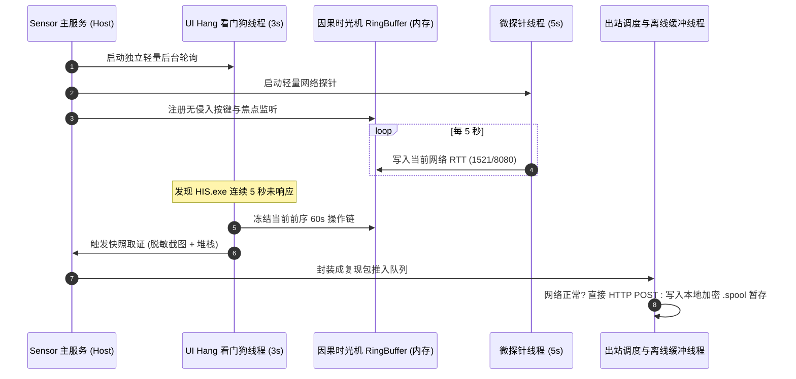
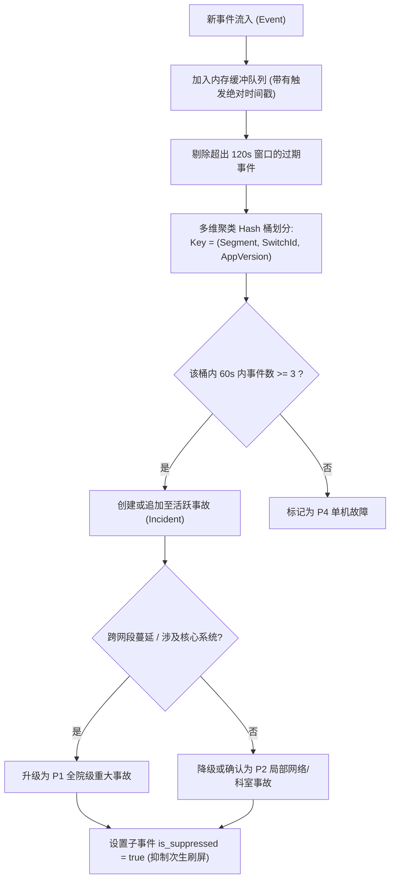

# HIOps 医院智能信息运维平台 — 详细技术设计方案 (LLD)

> **文档编号**: HIOps-LLD-2026-V2.0  
> **编制日期**: 2026-10-22  
> **技术栈基线**:  
> - 客户端: **C# .NET Framework 4.8 (AnyCPU)**，原生 P/Invoke，支持 Win7 SP1 x86 ~ Win11  
> - 服务端: **C# .NET 8 模块化单体** (HIOps.Api + 13个业务模块) + **PostgreSQL 17.5**  
> - 前端: **Vue 3 + Vite + Element Plus + ECharts / Cytoscape**  
> **设计目标**: 提供类图级别、线程模型级别、算法伪代码级别与接口契约级别的落地实施图纸，确保研发人员 100% 还原业务与技术设想。

---

## 1. 系统总体技术分层与模块边界

```mermaid
graph TD
    subgraph ClientLayer["终端探针层 (HIOps Endpoint Sensor .NET 4.8)"]
        direction TB
        C1["UiHangWatchdogWorker (UI 假死看门狗)"]
        C2["CrashEventLogWatcher (Event 1000/1001 监听)"]
        C3["ActionTrailTracker (前序 60s 操作时光机)"]
        C4["SyntheticNetProbeWorker (微探针 TCP RTT)"]
        C5["PiiMaskingEngine (敏感数据截屏脱敏)"]
        C6["EgressSpoolerDispatcher (离线缓冲与背压出站)"]
        C7["SysTrayCompanion (托盘助手与一键自愈)"]
    end

    subgraph ServerLayer["服务端中台 (.NET 8 模块化单体)"]
        direction TB
        S1["Ingress Gateway (数据接收与指纹去重)"]
        S2["SlidingWindowCorrelator (120s 滑动窗口聚类引擎)"]
        S3["TopologicalInhibitionEngine (拓扑依赖抑制引擎)"]
        S4["PrincipalRcaArbiter (主要矛盾因果分析器)"]
        S5["SyntheticJobScheduler (假人仿真拨测调度)"]
        S6["PlungeAnomalyDetector (业务量断崖突变检测)"]
    end

    ClientLayer -->|HTTP POST JSON (纯出站)| S1
    S1 --> S2 --> S3 --> S4
    S5 & S6 --> S2
```

---

## 2. 端侧智能探针 (HIOps Sensor) 内部架构与详细实现

### 2.1 客户端多线程并发模型与资源隔离
Sensor 严禁拖慢医生电脑，核心常驻采用**高内聚、低耦合的多工作线程模型**：



### 2.2 核心线程实现规范

#### (1) UI Hang 卡死无侵入检测器 (`UiHangWatchdogWorker.cs`)
- **设计原理**: 外部非注入式探测，避免被 360/火绒拦截。
- **关键 P/Invoke 声明与实现代码**:
```csharp
public class UiHangWatchdogWorker
{
    [DllImport("user32.dll", SetLastError = true, Timeout = 1000)]
    private static extern IntPtr SendMessageTimeout(IntPtr hWnd, uint Msg, IntPtr wParam, IntPtr lParam, 
        uint fuFlags, uint uTimeout, out UIntPtr lpdwResult);

    [DllImport("user32.dll")]
    private static extern bool IsHungAppWindow(IntPtr hWnd);

    private const uint SMTO_ABORTIFHUNG = 0x0002;
    private const uint WM_NULL = 0x0000;
    private readonly HashSet<string> _targetProcesses = new HashSet<string>(StringComparer.OrdinalIgnoreCase) 
    { 
        "HIS", "EMR", "LIS", "PACSViewer" 
    };

    public void CheckProcessHealth()
    {
        foreach (var proc in Process.GetProcesses())
        {
            if (!_targetProcesses.Contains(proc.ProcessName)) continue;
            IntPtr hWnd = proc.MainWindowHandle;
            if (hWnd == IntPtr.Zero) continue;

            // 超时阈值设为 5000ms
            IntPtr result = SendMessageTimeout(hWnd, WM_NULL, IntPtr.Zero, IntPtr.Zero, 
                SMTO_ABORTIFHUNG, 5000, out UIntPtr lpdwResult);

            if (result == IntPtr.Zero && IsHungAppWindow(hWnd))
            {
                // 确认卡死，触发 0.5s 快照取证流程
                ForensicOrchestrator.CaptureSnapshot(TriggerType.UI_HANG, proc, hWnd);
            }
        }
    }
}
```

#### (2) 因果时光机环形无锁缓冲区 (`RingBuffer<T>.cs`)
- **设计原理**: 平时完全不写磁盘，在内存中保持最近 60 秒的 50 条操作与微环境条目，采用双缓冲或轻量级读写锁。
```csharp
public class ActionTrailRingBuffer
{
    private readonly ActionEntry[] _buffer;
    private readonly int _capacity;
    private int _head = 0;
    private readonly ReaderWriterLockSlim _lock = new ReaderWriterLockSlim();

    public ActionTrailRingBuffer(int capacity = 50)
    {
        _capacity = capacity;
        _buffer = new ActionEntry[capacity];
    }

    public void Enqueue(ActionEntry entry)
    {
        _lock.EnterWriteLock();
        try
        {
            _buffer[_head] = entry;
            _head = (_head + 1) % _capacity;
        }
        finally { _lock.ExitWriteLock(); }
    }

    public List<ActionEntry> FreezeAndDump()
    {
        _lock.EnterReadLock();
        try
        {
            var list = new List<ActionEntry>(_capacity);
            for (int i = 0; i < _capacity; i++)
            {
                int idx = (_head + i) % _capacity;
                if (_buffer[idx] != null) list.Add(_buffer[idx]);
            }
            return list;
        }
        finally { _lock.ExitReadLock(); }
    }
}
```

#### (3) 敏感信息端侧几何脱敏引擎 (`PiiMaskingEngine.cs`)
- **设计原理**: 在客户端 GDI+ 截屏缓冲区中，识别典型窗体几何坐标（患者姓名栏、身份证号栏、医嘱病历正文），直接绘制纯黑矩形（`FillRectangle`）或应用均值模糊，严禁明文患者信息上传。

---

## 3. 服务端中台 (.NET 8) 核心智能算法详细设计

### 3.1 120 秒多维滑动窗口聚类算法 (`SlidingWindowCorrelator.cs`)



#### 算法伪代码实现：
```csharp
public class SlidingWindowCorrelator : BackgroundService
{
    private readonly Channel<IncidentEvent> _inputChannel;
    private readonly List<IncidentEvent> _slidingWindow = new();
    private readonly TimeSpan _windowDuration = TimeSpan.FromSeconds(120);

    protected override async Task ExecuteAsync(CancellationToken stoppingToken)
    {
        await foreach (var ev in _inputChannel.Reader.ReadAllAsync(stoppingToken))
        {
            DateTime now = ev.TriggeredAt;
            _slidingWindow.Add(ev);
            
            // 1. 剪枝：清理 120s 以前的陈旧事件
            _slidingWindow.RemoveAll(e => now - e.TriggeredAt > _windowDuration);

            // 2. 多维分组：按网段与接入交换机聚合
            var groups = _slidingWindow.GroupBy(e => new { e.SegmentPrefix, e.SwitchId });

            foreach (var g in groups)
            {
                // 如果同网段 60 秒内聚合事件数 >= 3，触发聚类收敛
                if (g.Count() >= 3)
                {
                    var parentIncident = await IncidentRepository.GetOrCreateActiveIncidentAsync(
                        g.Key.SegmentPrefix, g.Key.SwitchId);

                    foreach (var childEvent in g)
                    {
                        if (childEvent.IncidentId == null)
                        {
                            childEvent.IncidentId = parentIncident.Id;
                            childEvent.IsSuppressed = true; // 自动抑制，防止重复推警
                            await EventRepository.UpdateAsync(childEvent);
                        }
                    }
                    await NotificationDispatcher.BroadcastIncidentUpdateAsync(parentIncident);
                }
            }
        }
    }
}
```

---

### 3.2 主要矛盾因果分析算法 (RCA Arbiter)

#### 判定得分数学模型：
对滑动窗口内的每一个候选资产故障事件 $A$，计算其作为“主要矛盾根因”的得分：
$$\text{Score}(A) = 0.40 \cdot T_{\text{precedence}} + 0.35 \cdot D_{\text{topology}} + 0.25 \cdot E_{\text{explain}}$$

- **$T_{\text{precedence}}$ (时间先发性)**: 在窗口内最先发生异常者得 1.0 分，随时间衰减；
- **$D_{\text{topology}}$ (拓扑深度权重)**: 核心数据库/存储 = 1.0，核心汇聚网络 = 0.85，业务中间件 = 0.70，接入交换机 = 0.40，终端 PC = 0.10；
- **$E_{\text{explain}}$ (影响面解释度)**: 若该节点故障能逻辑推导出其余报警，得分按匹配率加权。

#### 核心判定决策树伪代码：
```csharp
public class PrincipalRcaArbiter
{
    public RcaVerdict Arbitrate(List<IncidentEvent> clusterEvents)
    {
        // 1. 检查是否存在核心基础设施事件 (DB 锁、存储 IOPS、核心交换机掉线)
        var rootCandidates = clusterEvents.Where(e => e.TopologyDepth >= 0.7).ToList();

        if (rootCandidates.Any())
        {
            // 按时间最早排序，寻找始作俑者
            var primary = rootCandidates.OrderBy(e => e.TriggeredAt).First();
            return new RcaVerdict
            {
                PrincipalContradiction = $"[{primary.SourceAssetName}] 发生异常引起全局卡顿 (责任方: {primary.EventType})",
                RootAssetId = primary.AssetId,
                Confidence = 0.95f,
                ActionAdvice = "处置核心服务/杀死数据库锁源会话，无需排查门诊终端电脑"
            };
        }

        // 2. 检查是否为局部接入交换机丢包
        var netEvents = clusterEvents.Where(e => e.EventType == "PORT_CRC_ERROR" || e.EventType == "PACKET_LOSS").ToList();
        if (netEvents.Count >= 2)
        {
            return new RcaVerdict
            {
                PrincipalContradiction = "楼层弱电接入层网络抖动引起终端断流",
                Confidence = 0.88f,
                ActionAdvice = "派单弱电网络科排查楼层跳线与接入交换机端口"
            };
        }

        // 3. 兜底判定为终端应用特异性缺陷
        return new RcaVerdict
        {
            PrincipalContradiction = "特定版本客户端异常闪退",
            Confidence = 0.75f,
            ActionAdvice = "通过小助手下发一键重置组件或联系 HIS 厂商升级"
        };
    }
}
```

---

## 4. 关键 API 接口契约规范 (Interface Contract)

### 4.1 终端出站取证上报接口 (`/api/v1/sensors/forensics/report`)
- **Method**: `POST`
- **Request Headers**:
  - `Content-Type`: `application/json`
  - `X-HIOps-Sensor-Token`: `HIOps-Auth-2026-X9`
- **Request Body (JSON)**:
```json
{
  "fingerprint_hash": "A9F3C184E0B195C8",
  "asset_code": "MZ-W-021_D45D6489A12B",
  "occurred_at": "2026-10-22T10:14:15.120+08:00",
  "trigger_type": "UI_HANG",
  "hang_duration_ms": 6200,
  "active_window_title": "门诊电子病历 - [处方开立]",
  "ocr_error_text": "ORA-00054: resource busy and acquire with NOWAIT specified",
  "stack_trace": "at Oracle.DataAccess.Client.OracleCommand.ExecuteNonQuery()...\nat HIS.Clinic.Prescription.Save()",
  "action_trail": [
    { "t_minus": "45s", "type": "UI_CLICK", "target": "Button[btn_SelectPatient]" },
    { "t_minus": "38s", "type": "SCANNER_INPUT", "target": "BarcodeScanner[Len=16]" },
    { "t_minus": "25s", "type": "UI_CLICK", "target": "Button[btn_InsuranceTrial]" },
    { "t_minus": "17s", "type": "NET_DEP", "target": "POST /insur/gateway Status=504 Latency=8500ms" },
    { "t_minus": "12s", "type": "UI_CLICK", "target": "Button[btn_Save] (DoubleClicked)" }
  ],
  "net_probes": [
    { "service": "ORACLE_1521", "rtt_ms": 0.8, "loss_rate": 0.0 },
    { "service": "HIS_GATEWAY_8080", "rtt_ms": 1.2, "loss_rate": 0.0 }
  ],
  "screenshot_thumb_base64": "iVBORw0KGgoAAAANSUhEUgAA..."
}
```
- **Response (200 OK)**:
```json
{
  "code": 200,
  "message": "Snapshot archived successfully",
  "data": {
    "snapshot_id": "8c411892-7f99-4d89-9a2e-8d2b772c91a0",
    "incident_id": "INC-20261022-0001",
    "auto_healing_suggested": null
  }
}
```

---

### 4.2 导出确定性复现报告接口 (`/api/v1/reproduction/export/{snapshotId}`)
- **Method**: `GET`
- **Response**: 返回标准 PDF 或 Markdown 格式文档，直接包含：
  1. 现场故障描述与受影响科室；
  2. 故障前序 60 秒人机交互复现步骤清单（1-2-3-4）；
  3. 微环境证明（网络延迟正常证明、接口响应超时记录）；
  4. 报错现场截图与脱敏文字。
  直接作为证据派发给 HIS/EMR 厂商，实现“无法推脱、依步骤 100% 稳定复现”。
