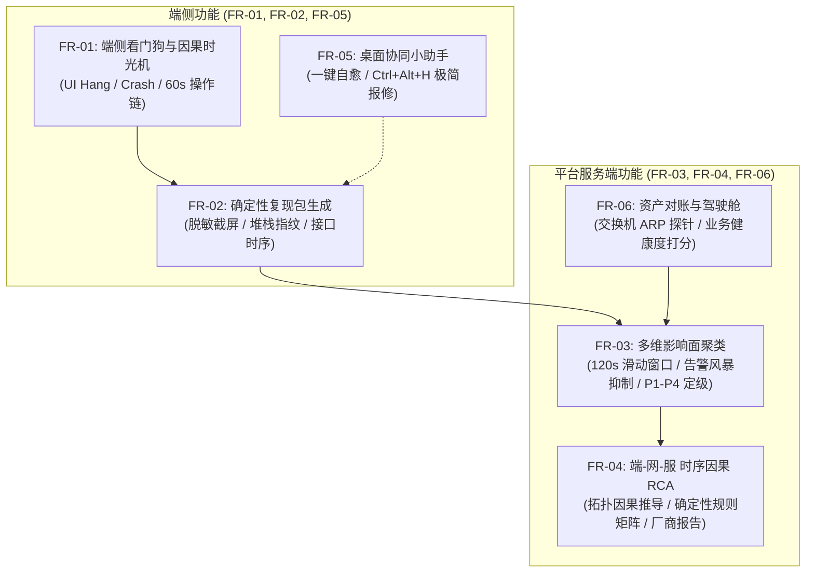

# HIOps 医院智能信息运维平台 — 软件需求规格说明书 (SRS)

> **文档编号**: HIOps-SRS-2026-V2.0  
> **编制日期**: 2026-10-22  
> **适用对象**: 医院信息中心、开发团队、软件评测机构、系统集成商及医院验收评审委员会  
> **项目定位**: 针对大型综合性医院上千台终端、数十种异构系统（HIS/EMR/LIS/PACS 等）的“端-网-服”全链路可观测、故障因果回溯（破局难复现）、多维影响面分析、自动根因定位与医护协同自愈平台。

---

## 1. 引言

### 1.1 编写目的
本需求规格说明书旨在明确 **HIOps 医院智能信息运维平台** 的业务功能、技术边界、性能指标与合规性要求。作为系统开发、迭代、部署以及阶段性成果验收的法律与技术依据，确保系统能够真正解决医院一线运维中“**医护被动报修、偶发故障极难复现（结果有了，不知道怎么产生的）、现场缺乏证据、影响面难评估、根因互相扯皮**”的核心瓶颈。

### 1.2 建设背景与痛点定义
当前医院网络与信息化架构具备“三高一老”特征：
1. **业务并发高、依赖复杂度高**: 60+ 业务系统深度耦合于 HIS 与前置网关，单机涉及十余种 COM/ActiveX 组件；
2. **终端体量大、分布广**: 1000+ 终端分布在 6 大隔离网段（10/20/30/31/40/50），物理跨越多座大楼及弱电井；
3. **老旧系统与操作系统长尾共存**: 临床存在大量 Windows 7 SP1 x86 终端与机械硬盘 PC；
4. **运维痛点突出**:
   - **被动救火**: 医护遭遇问题全凭电话报修，信息中心无法提前获知；
   - **难复现（核心死穴）**: 报错或卡死结果已发生，但由于无法复现前序 60 秒的操作时序和依赖状态，厂商以“现场无法复现”关闭工单；
   - **告警风暴与边界不明**: 局部弱电交换机丢包引发数十个诊室同时报修，缺乏影响面空间聚类能力。

### 1.3 术语与缩略语
- **HIOps**: Hospital Intelligent Operations Platform，医院智能信息运维平台。
- **Sensor**: 驻留于临床 Windows 终端的轻量自研端侧探针。
- **UI Hang**: 客户端主线程消息循环阻塞超过阈值（默认 5s）造成的界面假死现象。
- **User Action Trail (前序因果时光机)**: 记录异常触发前 60 秒内无侵入的用户高层操作行为（点击、按键、扫码）与接口时序。
- **Deterministic Reproduction Packet (确定性复现包)**: 包含前序操作链、网络微探针时序、调用堆栈及脱敏截屏的标准故障报告包。
- **Sliding Window (滑动时间窗口)**: 后端基于时序事件流进行多维空间聚合的动态时间范围（默认 120 秒）。
- **RCA**: Root Cause Analysis，根因分析。

---

## 2. 总体业务描述与系统边界

### 2.1 用户角色与核心诉求
| 角色 | 核心使用场景 | 核心诉求 |
|---|---|---|
| **临床医护人员** (医生、护士、收费员) | 诊疗开方、刷卡挂号、医嘱录入、发票打印 | 遇到问题不打电话，一键自愈；无法自愈时一键带截图报修，拒绝繁琐沟通。 |
| **桌面运维工程师** | 终端故障排查、外设调试、客户端补丁 | 接单即获知准确科室、IP、报错截图、前序步骤与调用栈，不再空跑现场。 |
| **网络运维工程师** | 楼层交换机、VLAN、弱电井排查 | 实时获知受影响终端网段分布，快速定界是跳线松动还是核心交换机风暴。 |
| **系统/DBA/厂商** | 数据库死锁、接口超时、软件 Bug 修复 | 拿到标准《确定性复现报告》，获得 100% 稳定的复现步骤，快速定位代码缺陷。 |
| **信息科主任/分管院长** | 全院业务健康度大屏感知、考核分析 | 掌握门诊/急诊/住院核心系统健康指数，量化统计高频故障与响应效率提升。 |

### 2.2 物理网络与架构约束
1. **纯出站单向网络**: 终端网段（192.168.10/20/30/31/40/50）至服务器段（192.168.114.X）仅开放特定出站端口（TCP 10051 / HTTP 5080）。服务器入站到终端 100% 隔离阻断。
2. **端侧轻量化与零干扰**: Sensor 必须支持 Win7 x86~Win11 全覆盖，严禁安装第三方大型运行时，内存常驻 $<15\text{MB}$，CPU 占用 $<0.5\%$，平时严禁写入磁盘。
3. **数据合规安全红线**: 严禁采集患者敏感隐私数据（如患者明文姓名、身份证号全称、完整病历文本）。截屏与取证必须在端侧完成动态遮罩脱敏。

---

## 3. 详细功能需求 (Functional Requirements)

### 3.1 FR-01: 端侧看门狗与前序因果时光机
*   **FR-01-01 [UI Hang 无侵入监测]**: Sensor 应以后台独立轻量线程，每 3 秒使用 Windows 原生 API（`SendMessageTimeout` 设定 5000ms 超时并核验 `IsHungAppWindow`）对配置的白名单核心进程（`HIS.exe`, `EMR.exe`, `LIS.exe`, `PACSViewer.exe`）进行心跳巡查。一旦超过 5 秒未响应，自动判定为 UI Hang 并触发取证。
*   **FR-01-02 [系统级崩溃实时捕获]**: Sensor 应通过 `EventLogWatcher` 挂载系统 `Application` 通道，实时监听 `EventID IN (1000, 1001, 1026)`，提取崩溃进程、故障模块（Faulting Module）及异常代码（Exception Code）。
*   **FR-01-03 [前序操作序列内存记录 (因果时光机)]**:
    *   在客户端内存开辟固定容量的环形缓冲区（容量 50 条），无侵入记录前 60 秒内的用户操作流水；
    *   记录类别涵盖：按钮与菜单点击（`UI_CLICK`，仅记录控件 ID 如 `btn_Save`）、扫描枪外设输入（`SCANNER_INPUT`，仅记录扫码事件与长度）、窗口激活与焦点切换（`WINDOW_SWITCH`）、功能按键（`KEY_ACTION` 如 Enter/F5）；
    *   **严禁记录具体输入的敏感业务字符**，确保合规与极低内存开销。
*   **FR-01-04 [端侧网络微探针]**: Sensor 每 5 秒对核心数据库（1521/1433）和业务网关（8080/443）执行轻量 TCP SYN/ACK 探测，记录最近 3 分钟的 RTT 时延与丢包率。

### 3.2 FR-02: 确定性复现包与现场证据生成
*   **FR-02-01 [异常指纹计算 (Fingerprint)]**:
    *   对捕获的异常自动计算 SHA1 指纹：`Fingerprint = SHA1(ProcessName + Module + ExceptionCode + StackHash)`；
    *   用于在服务端自动聚合同一代码缺陷引起的成百上千次报错。
*   **FR-02-02 [现场报错弹窗捕获与 OCR]**:
    *   当核心进程弹出异常对话框（`#32770` 类）时，自动捕获该窗口矩形区域图像；
    *   遍历控件提取 `Static` 类控件文本，提取确切的数据库或中间件错误文本（如 *ORA-00054*, *SocketTimeoutException*）。
*   **FR-02-03 [敏感数据端侧动态脱敏]**:
    *   对截取的界面图片，Sensor 本地通过预设几何遮罩算法，对病历正文、患者姓名、身份证号码区域执行高斯模糊（模糊半径 $>15$）或纯黑遮罩覆盖后再进行压缩编码。
*   **FR-02-04 [生成标准化复现数据包]**:
    *   整合“前序 60 秒操作链 + 依赖接口返回耗时 + 报错截屏 + 调用栈 + 本地环境指纹”，封装为标准 JSON 格式的 `DeterministicReproductionPacket`。

### 3.3 FR-03: 影响面多维聚类与告警收敛抑制
*   **FR-03-01 [四维标签注入]**: 服务端接收到取证数据包后，结合 CMDB 资产库与交换机拓扑，自动注入：
    1. `Segment`: 终端所属网段（10/20/30/31/40/50）；
    2. `SwitchId`: 物理接入交换机及端口；
    3. `DepartmentId`: 所属物理科室与诊区；
    4. `AppVersion`: 客户端程序版本与补丁号。
*   **FR-03-02 [120 秒滑动时间窗口聚类]**:
    *   在动态 120 秒滑动窗口内对流入事件执行空间关联计算；
    *   **P1 (全院级重大事故)**: 跨网段、跨科室同时有 $\ge 3$ 台终端上报核心服务超时 $\to$ 触发全院一级响应；
    *   **P2 (局部网络/环境事故)**: 集中在同一网段（如 192.168.20.X）或同一弱电接入交换机 $\to$ 收敛为该区域网络故障；
    *   **P3 (软件缺陷/版本冲突)**: 集中在特定版本或杀软策略 $\to$ 归类为应用代码缺陷；
    *   **P4 (单机级特异故障)**: 孤立事件 $\to$ 触发单机自愈或派发桌面单。
*   **FR-03-03 [告警风暴抑制与反向通告]**:
    *   判定为 P1/P2 时，该窗口内所有单机报错自动合并到主事故单下，禁止向工程师手机发送重复报警；
    *   向受影响区域的所有终端桌面小助手反向广播状态通告（如：*“信息中心已知晓门诊2楼网络异常，正在紧急修复中，预计10分钟恢复，无需报修”*），阻断电话呼叫。

### 3.4 FR-04: “端-网-服”时序因果根因分析 (RCA)
*   **FR-04-01 [时序强对齐引擎]**:
    *   建立时间窗口对齐机制（端侧报错时刻 $T$，向前回溯 60 秒至向后延伸 10 秒）；
    *   将端侧微探针 RTT、接入交换机 SNMP 端口丢包率、服务端 Zabbix 采集的数据库会话数/行锁等待进行因果序列关联。
*   **FR-04-02 [确定性根因推导矩阵]**:
    *   根据预设的临床确定性推导规则，秒级判定根因责任方（区分终端、弱电网、核心数据库、中间件服务）。
*   **FR-04-03 [一键导出厂商复现报告]**:
    *   平台支持一键导出 PDF/Markdown 格式的《标准故障复现说明书》，清晰列出：“前序步骤 1-2-3”、“网络微环境良好证明（排除医院网络问题）”、“报错堆栈与截屏”，使软件厂商无法推脱。

### 3.5 FR-05: 桌面协同小助手与本地一键自愈
*   **FR-05-01 [Windows 任务栏极简状态托盘]**:
    *   常态显示绿色盾牌（网络延迟 $<5\text{ms}$ 且核心服务畅通）；
    *   网络抖动或丢包率 $>10\%$ 时显示黄色问号；核心阻断时显示红色感叹号。
*   **FR-05-02 [高频顽疾一键自愈]**: 提供高权限静默执行的自愈动作：
    1. **打印机一键修复**: 清空 `PRINTERS` 假死队列并重启 `spoolsv`；
    2. **业务缓存一键清理**: 清理 HIS/EMR 损坏的临时报表与 Local Temp；
    3. **网络与 DNS 一键修复**: 执行 `ipconfig /flushdns` 并重置 Winsock 套接字。
*   **FR-05-03 [全局热键一键因果提单]**:
    *   支持医护按下 `Ctrl + Alt + H`，无需打字，直接捕获前序时光机与脱敏截图生成工单。

### 3.6 FR-06: 基础设施资产对账与驾驶舱
*   **FR-06-01 [交换机 ARP 探针与资产对账]**:
    *   对接 Zabbix 读取交换机 ARP 表（`ipNetToMediaTable`），比对在线 IP/MAC 与 HIOps 资产库，标记未安装 Sensor 的“裸奔”终端。
*   **FR-06-02 [全院业务健康度大屏驾驶舱]**:
    *   自底向上计算门诊、急诊、住院、医技四大板块的实时业务健康分（0~100 分），分档显示（$\ge 95$ 绿、80~94 黄、$<80$ 红）。

---

## 4. 非功能需求 (Non-Functional Requirements)

### 4.1 性能与资源消耗硬指标 (NFR-Performance)
*   **NFR-P-01 [端侧 CPU 占用率]**: 在日常静默监控状态下，Sensor 进程 CPU 占用率必须 $\le 0.5\%$（单核基准）；执行取证或截屏时，瞬间 CPU 占用率 $\le 5\%$ 且持续时间 $\le 1$ 秒。
*   **NFR-P-02 [端侧内存常驻]**: Sensor 进程的工作集内存占用必须 $\le 15\text{MB}$，峰值占用严禁超过 $30\text{MB}$。
*   **NFR-P-03 [磁盘 I/O 零损耗]**: 在正常运行且无故障触发时，Sensor 严禁产生持续磁盘写 I/O；所有时序记录与因果时光机数据必须驻留于内存环形缓冲区。
*   **NFR-P-04 [服务端处理吞吐量]**: HIOps 服务端 API 在单机配置下，应支持每秒处理 $\ge 500$ 个并发的心跳与取证上报请求；滑动窗口聚类计算耗时 $\le 2$ 秒。

### 4.2 可靠性与离线保活 (NFR-Reliability)
*   **NFR-R-01 [离线缓冲机制 (Spooling)]**: 当医院网络中断或 HIOps 服务端不可达时，Sensor 取证数据包必须自动加密写入本地磁盘缓冲队列（最大磁盘上限 $50\text{MB}$），先进先出淘汰；网络恢复后自动带背压（间隔 3 秒、每次 1 包）补发，严禁数据丢失与雪崩冲垮。
*   **NFR-R-02 [自拉起与防崩溃]**: Sensor 必须注册为 Windows 服务或受系统任务计划看护，遭遇异常退出时必须在 30 秒内自动重启恢复。

### 4.3 兼容性 (NFR-Compatibility)
*   **NFR-C-01 [全环境兼容]**: Sensor 必须原生兼容运行于 Windows 7 SP1 (x86/x64)、Windows 10 (x86/x64) 以及 Windows 11 环境。
*   **NFR-C-02 [杀软协同互认]**: 安装脚本与主程序必须通过主流医院安全软件（360 天擎、火绒企业版、联软）的合规探测，严禁触发动态注入报毒或被静默拦截。

### 4.4 安全性与隐私保护 (NFR-Security)
*   **NFR-S-01 [端到端通信加密]**: Sensor 与 HIOps 后端 API 之间必须采用全出站 HTTPS/TLS 加密传输，请求报文携带专属签名 Token，防止中间人伪造与重放攻击。
*   **NFR-S-02 [患者数据脱敏红线]**: 取证图片与文本在离开终端内存前，必须完成敏感个人信息（PII）自动遮罩；存储于 PostgreSQL 中的取证截图必须经过 AES-256 加密保存。

---

## 5. 系统接口规范

### 5.1 终端出站上报接口
- **URL**: `POST /api/v1/sensors/forensics/report`
- **认证**: Request Header 携带 `X-HIOps-Sensor-Token` 与 `X-HIOps-Machine-Fingerprint`。
- **Payload 核心字段**:
  - `Fingerprint`: 异常指纹字符串 (SHA1)
  - `OccurredAt`: 故障绝对时间戳 (ISO 8601, 毫秒级)
  - `HangDurationMs`: UI 假死时长
  - `ActionTrail`: 前序 60 秒操作序列列表 (JSON 数组)
  - `NetProbes`: 最近 3 分钟网络 RTT 序列
  - `ScreenshotBase64`: 脱敏压缩图像流
  - `StackDetails`: 崩溃模块与堆栈文本

### 5.2 Zabbix API 差分联动接口
- **方式**: 服务端定时任务（每 20 秒）通过 JSON-RPC `problem.get` 拉取全院未恢复的故障；
- **回写**: 指标拉取 `item.get` 自动入库，并在恢复时自动触发差分消警闭环。
