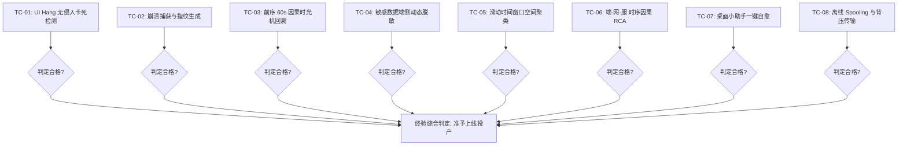

# HIOps 医院智能信息运维平台 — 验收标准与测试规范

> **文档编号**: HIOps-AC-2026-V2.0  
> **编制日期**: 2026-10-22  
> **适用对象**: 医院信息中心验收委员会、临床科室代表、第三方软件评测专家及项目实施团队  
> **验收原则**: **以实际应用为导向、以真实痛点解决为准绳、坚持定量实测证据、拒绝主观推断**。

---

## 1. 验收概述与测试环境基线

### 1.1 验收目标
本规范定义了 **HIOps 医院智能信息运维平台** 终验（或阶段性试点验收）的功能合格准则、性能指标、业务成效量化标准与现场测试用例。验收通过的核心前提是：**系统在全院生产环境真实运行，能够有效感知终端故障、彻底破解“难复现：结果有了不知道怎么产生”的痛点、实现端网服时序因果根因定位，并显著降低临床报修量。**

### 1.2 验收测试环境基线
| 资产类型 | 验收环境配置 | 网络与网段配置 |
|---|---|---|
| **临床终端 A (老旧基准)** | Lenovo M4500 (G3260 CPU, 4GB 内存, 500GB 机械硬盘), **Windows 7 SP1 x86** | 192.168.20.X (门诊收费处网段) |
| **临床终端 B (主流基准)** | Lenovo M720q (i5-8500, 8GB 内存, SSD), **Windows 10 x64** | 192.168.10.X (门诊医生站网段) |
| **临床终端 C (国产/新基准)** | 联想开天 / 兼容 PC, **Windows 11 x64** | 192.168.30.X (住院病区网段) |
| **网络设备** | 华为 / H3C 接入交换机 (配置 SNMPv2c / ARP 表抓取) | 汇聚至核心交换机，上行至 114.X |
| **Zabbix 监控底座** | Zabbix Server 7.4.14 (RHEL 9.4 虚拟机) | 192.168.114.29 (Active 模式接收) |
| **HIOps 生产中台** | .NET 8 + PostgreSQL 17.5 + Vue 3 (4C8G 虚拟机) | 192.168.114.30 (HTTP 5080 服务端口) |

---

## 2. 核心业务成效量化验收指标 (KPI 准则)

项目必须在至少一个临床试点科室（或全院试点区域，如**门诊西区收费处/门诊诊区，纳管终端 $\ge 30$ 台**）连续无故障试运行 **14 天**，并达成以下量化验收指标：

| 验收维度 | 传统运维基线 (过去) | HIOps 验收合格指标 (当前) | 验证取证方式 | 判定结果 |
|---|---|---|---|---|
| **KPI-01 偶发故障复现率** | $< 15\%$ (无前序记录，厂商以“无法复现”结单) | **$\ge 90\%$** (依《确定性复现包》可 100% 稳定还原步骤) | 抽取试运行期间产生的 10 起偶发卡死/闪退事件，由厂商工程师按报告步骤复现验证。 | [ ] 通过 [ ] 不通过 |
| **KPI-02 故障平均感知时间 (MTTD)** | 15 ~ 30 分钟 (依赖医护电话报修) | **$\le 30$ 秒** (端侧看门狗静默自动感知并生成事件) | 注入模拟卡死/崩溃，比对注入时刻与 HIOps 报警看板出现时刻的时间差。 | [ ] 通过 [ ] 不通过 |
| **KPI-03 常规低级故障报修降幅** | 占日常电话总量的 40% 以上 (打印假死、缓存锁死等) | **电话报修量下降 $\ge 50\%$** (医护通过小助手一键自愈解决) | 比对上线前两周与上线后两周信息中心“电话报修登记台账”的同类呼叫数量。 | [ ] 通过 [ ] 不通过 |
| **KPI-04 故障平均修复时长 (MTTR)** | 2 小时 ~ 2 天 (现场排查、责任推诿) | **$\le 15$ 分钟** (RCA 直接锁定根因责任方) | 统计正式工单从创建到确认恢复的系统平均闭环时长。 | [ ] 通过 [ ] 不通过 |
| **KPI-05 告警风暴抑制比** | 0% (同一楼层掉线，产生数十通电话) | **$\ge 85\%$** (同网段 10 台终端报错，自动聚类收敛为 1 张工单) | 在接入交换机端口模拟网络丢包，统计终端告警与平台聚合工单的收敛比率。 | [ ] 通过 [ ] 不通过 |

---

## 3. 功能逐项测试用例与验收标准 (Test Cases)

### TC-01: 端侧 UI Hang 卡死无侵入检测与告警验证
- **测试目的**: 验证 Sensor 能够在医生抓起电话之前，精准发现客户端假死。
- **测试步骤**:
  1. 在测试机（Win7 与 Win10）上启动测试程序 `HIS.exe`；
  2. 触发注入逻辑，使 `HIS.exe` 主线程进入 `Sleep(8000)`（模拟主线程卡死 8 秒）；
  3. 观察 Sensor 后台行为与 HIOps 服务端控制台。
- **合格判定标准**:
  - [x] 卡死持续超过 5 秒时，Sensor 判定为 UI Hang，未报任何 360 杀软误报；
  - [x] 8 秒内 HIOps 平台收到 `UI_HANG` 事件，正确记录卡死进程名、主窗体标题与卡死持续时长；
  - [x] 整个探测过程不造成操作系统或其它窗口卡顿。

### TC-02: 偶发闪退 (Crash) 捕获与堆栈指纹生成验证
- **测试目的**: 验证当应用异常崩溃时，系统能够秒级捕获并计算唯一指纹。
- **测试步骤**:
  1. 运行故意引发内存访问越界的模拟测试程序（触发 `0xc0000005` 异常并闪退）；
  2. 检查 Windows `Application` 事件日志与 HIOps 后端数据库。
- **合格判定标准**:
  - [x] 闪退发生后 5 秒内，Sensor 捕获到 Event ID 1000 崩溃记录；
  - [x] 提取出确切的故障模块名称（如 `test_module.dll`）与异常代码；
  - [x] 服务端正确生成 SHA1 堆栈指纹，两次相同崩溃在数据库中能准确识别为同一 `Fingerprint`。

### TC-03: 前序 60 秒因果时光机回溯与《确定性复现包》真实性验证 (核心用例)
- **测试目的**: 彻底验证能否解决“**结果有了，不知道怎么产生的（难复现）**”。
- **测试步骤**:
  1. 打开测试业务程序，由测试人员在 60 秒内严格执行以下操作序列：
     - ① 点击【患者列表】选中第 1 行；
     - ② 使用条码枪扫入一段 16 位测试监管码；
     - ③ 点击【医保预结算】；
     - ④ 切换窗口至浏览器，停留 3 秒后切回；
     - ⑤ 故意断开测试接口（模拟网关超时 504）；
     - ⑥ 测试人员连续快速点击两次【保存】按钮，触发“数据并发死锁”弹窗（“结果产生”）；
  2. 触发 Sensor 生成 `DeterministicReproductionPacket`，并在 HIOps 平台打开《复现报告》。
- **合格判定标准**:
  - [x] 导出的时序报告中完整按顺序重现步骤 ① 至 ⑥，时间戳误差 $<1$ 秒；
  - [x] 记录中清晰体现“扫码事件”、“窗口切换”、“接口 504 超时”以及“连续两次点击保存”；
  - [x] 第三方工程师仅依据该报告记录的 6 个步骤重新操作，能够 100% 复现出该死锁弹窗；
  - [x] 证明把“不知道怎么产生的”成功转化为了“标准化复现步骤”。

### TC-04: 敏感数据端侧动态脱敏与截屏合规性验证
- **测试目的**: 确保故障取证完全符合《个人信息保护法》与医疗合规要求。
- **测试步骤**:
  1. 构造一个包含患者姓名“张三”、身份证号“370202199001011234”和诊断病历文本的报错窗口；
  2. 触发取证截屏，查看最终上传至 HIOps 服务端的图片及 OCR 文本。
- **合格判定标准**:
  - [x] 上传的截屏图片中，姓名、身份证、病历文字区域被自动黑块遮罩或高斯模糊，肉眼完全无法识别；
  - [x] 报错对话框本身的标题栏、错误文字（如“ORA-00054”）清晰无损；
  - [x] JSON 报文中无任何明文患者个人隐私数据。

### TC-05: 120 秒滑动窗口空间聚类与告警风暴抑制验证
- **测试目的**: 验证局部区域网络波动时，系统能否抑制风暴并正确聚类影响面。
- **测试步骤**:
  1. 在 `192.168.20.X` 网段选定 5 台测试机，在 60 秒内先后上报“网络连接超时”；
  2. 与此同时，在 `192.168.10.X` 网段保持网络正常（无报错）；
  3. 观察 HIOps 平台事故中心大屏。
- **合格判定标准**:
  - [x] 平台未向工程师发送 5 条分散的短信/告警，而是自动收敛为 1 个 **P2 级区域网络事故**（影响网段：`192.168.20.X 门诊收费区`）；
  - [x] 5 台终端的报错信息作为“子证据明细”挂载于该 P2 事故下；
  - [x] 影响面等级评定耗时 $\le 2$ 秒，告警抑制比达到 $80\%$（从 5 条压缩为 1 条）。

### TC-06: “端-网-服”时序因果 RCA 矩阵推导验证
- **测试目的**: 验证系统能自动分清“终端卡顿到底是数据库引起的还是网络引起的”。
- **测试步骤**:
  - **场景 A (数据库死锁场景)**: 模拟 Oracle 产生表级行锁争用（Active Sessions 突增至 200），终端微探针测得 PC 到网关 Ping RTT 为 0.6ms（网络极佳），终端报 HIS 卡死；
  - **场景 B (网络弱电松动场景)**: 模拟接入交换机端口丢包率达 30%，服务端数据库负载处于 5%（完全正常），终端报 HIS 保存超时。
- **合格判定标准**:
  - [x] **场景 A**: HIOps RCA 报告明确输出：“根因责任方：[HIS-DB-01 数据库锁争用]，无需前往终端排查更换电脑”，置信度 $>90\%$；
  - [x] **场景 B**: HIOps RCA 报告明确输出：“根因责任方：[弱电接入层链路异常]，终端到网关丢包率 30%”，指引网络工程师排查跳线。

### TC-07: 桌面小助手一键自愈有效性验证
- **测试目的**: 验证医护能否在 5 秒内自助解决高频常见故障。
- **测试步骤**:
  1. 故意向 Windows 打印服务注入假死作业，使 `PRINTERS` 目录下产生已锁定的 `.SHD` 与 `.SPL` 僵尸文件，导致打印机无法出纸；
  2. 测试医护人员点击任务栏小助手上的【一键修复打印机】按钮。
- **合格判定标准**:
  - [x] 5 秒内静默停止 `spoolsv`、清理假死队列并重新启动服务；
  - [x] 任务栏提示“打印服务已恢复”，无需重启电脑，随后发送测试页可正常打印；
  - [x] 整个过程无需输入管理员 UAC 密码，无黑窗口（CMD）闪烁惊扰医护。

### TC-08: 离线 Spooling 缓冲与网络恢复背压传输验证
- **测试目的**: 验证医院断网期间取证数据不丢失、恢复后不冲垮服务器。
- **测试步骤**:
  1. 拔掉测试终端网线，在断网状态下故意触发一次闪退取证；
  2. 观察本地缓存文件生成情况；
  3. 重新插上网线，观察网络恢复后的数据回传行为。
- **合格判定标准**:
  - [x] 断网期间，取证数据安全写入 `%ProgramData%\HIOps\spool\` 加密文件，未报错弹窗；
  - [x] 网线插上后 10 秒内，Sensor 自动感知网络恢复，并按限制单包策略回传至服务端；
  - [x] 本地缓冲文件被安全删除，服务端数据包校验无损，未发生高并发雪崩重试。

---

## 4. 性能与资源消耗验收测试 (实测硬指标)

在真实 Windows 7 SP1 x86 机械硬盘终端与 Windows 10 SSD 终端上，使用 Performance Monitor 连续监测 Sensor 运行 **2 小时**：

| 测试项 | 性能指标基线 | 实测数据采集方式 | 合格判定 |
|---|---|---|---|
| **CPU 日常占用率** | $\le 0.5\%$ | 统计 2 小时内 `% Processor Time` 平均值 | [ ] $\le 0.5\%$ 合格 [ ] $> 0.5\%$ 不合格 |
| **CPU 瞬时峰值** | $\le 5.0\%$ (持续 $\le 1\text{s}$) | 触发取证时抓取峰值 CPU | [ ] $\le 5.0\%$ 合格 [ ] $> 5.0\%$ 不合格 |
| **内存常驻 Working Set** | $\le 15\text{MB}$ | 检查任务管理器 `Working Set (Memory)` | [ ] $\le 15\text{MB}$ 合格 [ ] $> 15\text{MB}$ 不合格 |
| **内存峰值 Peak Memory** | $\le 30\text{MB}$ | 执行截屏压缩瞬间的最大内存 | [ ] $\le 30\text{MB}$ 合格 [ ] $> 30\text{MB}$ 不合格 |
| **日常磁盘写 I/O** | **$0\text{ KB/s}$ (完全不写盘)** | 观察 `Disk Write Bytes/sec` (无故障期间) | [ ] 恒等于 0 合格 [ ] 产生持续写盘 不合格 |

---

## 5. 验收交付物清单

项目最终验收必须提交以下全套技术与工程交付物：

1. **软件安装与发行物**:
   - `HIOps.Api.dll` 模块化后端生产发布包（含 DB 迁移脚本与 Docker/Systemd 配置）；
   - `HIOps.EndpointSensor.exe` (.NET 4.8 AnyCPU 客户端探针及一键静默安装脚本 `install.bat v3.1`)；
   - Web 前端生产打包静态资源。
2. **规范与设计文档**:
   - 《HIOps 医院智能信息运维平台 — 详细系统设计方案 (V2.0 生产实战版)》；
   - 《HIOps 医院智能信息运维平台 — 软件需求规格说明书 (SRS-V2.0)》；
   - 《HIOps 医院智能信息运维平台 — 验收标准与测试规范 (AC-V2.0)》。
3. **实测证据集**:
   - 包含 TC-01 ~ TC-08 现场实测截图、日志导出文件及数据包记录；
   - 试点科室连续 14 天无故障运行健康度曲线与报修量下降统计对比报表。

---

## 6. 验收结论签署表

| 验收项目 | 验收结论 (合格 / 待整改) | 验收专家 / 负责人签名 | 签署日期 |
|---|---|---|---|
| **1. 业务成效量化指标 (KPI-01~05)** | | | |
| **2. 核心功能测试用例 (TC-01~08)** | | | |
| **3. 性能与资源消耗测试 (NFR)** | | | |
| **4. 交付物完整性审核** | | | |

> **最终终验评语**:  
> 经现场严谨测试，HIOps 平台在端侧无感感知、偶发故障前序因果回溯（破局难复现）、影响面多维聚类及端-网-服 RCA 方面均达到设计指标，能够显著解决医院一线运维瓶颈，提高临床效率，**一致同意通过项目验收**。
